# ARCHITECTURE — le « comment » de l'ESN virtuelle

> Ce document décrit l'architecture **du système multi-agents**, pas celle d'un projet client.
> L'architecture d'un projet client se trouve dans `projets/<slug>/architecture.md`.
> Vision : [VISION.md](VISION.md) · Règles du coordinateur : [CLAUDE.md](../CLAUDE.md) · Décisions : [decisions/](decisions/)

## 1. Objet

L'ESN est un ensemble d'agents spécialisés, orchestrés par un coordinateur unique. Ils travaillent sur des espaces projets isolés et communiquent par des fichiers Markdown versionnés. Les humains valident les étapes clés et modifient les règles.

## 2. Principes techniques

| Brique | Rôle | Emplacement |
|---|---|---|
| Claude Code, session principale | Coordinateur | `CLAUDE.md` |
| Subagents Claude Code | Agents spécialisés | `.claude/agents/*.md` |
| Skills | Procédures réutilisables (ticket, avancement, événements…) | `.claude/skills/<nom>/SKILL.md` |
| Hooks et permissions | Validations humaines appliquées techniquement | `.claude/settings.json`, `.claude/hooks/` |
| Templates | Format de chaque livrable | `templates/` |
| Runbooks | Procédures de crise | `runbooks/` |
| Scripts Python | Tableaux de bord, contrôles | `scripts/` |
| GitHub Actions | Tests, sécurité, tableaux, contrôle des validations (aucun déploiement) | `.github/workflows/` |
| Docker (production locale) | Hébergement par défaut des apps clientes, sur le poste de démonstration (DEC-003) | `deploiement/`, voir § 9 |

## 3. Arborescence

Légende : `(A)`, `(B)`, `(C)` ou `(D)` désigne le responsable ; `[gén.]` signale un fichier généré, à ne jamais modifier à la main.

```
/
├── CLAUDE.md                         (B) coordinateur
├── README.md
├── PORTFOLIO.md                      [gén.] vue de tous les projets
├── .gitattributes                    fins de ligne LF
├── .gitignore                        (C) deploiement/local/ (sauvegardes, secrets locaux) ; console/ et
│                                     qui-fait-quoi.html, générés (DEC-012, DEC-014)
├── qui-fait-quoi.html                [gén.] ignoré par Git, produit par scripts/qui_fait_quoi.py
├── requirements.txt                  (D) dépendances Python des scripts (PyYAML)
├── deploiement/
│   ├── docker-compose.yml            (C) modèle de production locale : app + Postgres (§ 9)
│   └── local/<slug>/                 ignoré par Git : sauvegardes/*.dump, historique.json, db_password
├── .claude/
│   ├── settings.json                 (C) permissions allow/ask/deny + déclaration des hooks
│   ├── hooks/proteger_valide.py      (C) hook PreToolUse Write/Edit : R5, R6, R9, templates (§ 6)
│   ├── hooks/restreindre_bash.py     (C) hook PreToolUse Bash : restrictions par agent ; R17 pour tout
│   │                                 appelant (§ 6, garde-fous 7 et 9)
│   ├── agents/*.md                   catalogue (§ 4)
│   └── skills/
│       ├── creer-ticket/  avancement/  nouveau-projet/  tracer-decision/        (B)
│       ├── arrivee-membre/  depart-membre/  absence/  revision-budget/          (B)
│       ├── verifier-prod/  (SKILL.md + verifier_prod.py)                        (C)
│       └── recette/                  procédure du salarié recetteur             (C)
├── .github/workflows/
│   ├── ci.yml                        (C) tous les scripts/test_*.py (test Docker réel compris)
│   ├── securite.yml                  (C) pip-audit, bandit, gitleaks
│   ├── tableau.yml                   (C) régénère TABLEAU/PORTFOLIO (cron quotidien)
│   └── validations.yml               (C) contrôle VALIDÉ ⇔ valide_par + decision
│                                     aucun deploy.yml : la production est locale (DEC-003)
├── docs/
│   ├── VISION.md  ARCHITECTURE.md  CHANGELOG-REGLES.md
│   ├── systemes/S1..S4-*.md          un fichier par système (responsable du système)
│   └── decisions/                    AAAA-MM-JJ-DEC-NNN-<sujet>.md
├── templates/                        (A) _ENTETE.md + un template par livrable
├── runbooks/                         (D) perte-donnees, coupure-serveur, intrusion, rollback
├── equipe/                           (B) membres/<prenom>.md, agents.md, calendrier.md
│                                     écrit uniquement par le coordinateur, après décision humaine ;
│                                     les agents le lisent
├── veille/AAAA-Sxx.md                (D) veille commune à l'ESN
├── scripts/
│   ├── tableau.py  test_tableau.py   (D)
│   ├── sonde_sante.py  test_sonde_sante.py                        (D)
│   ├── test_proteger_valide.py  test_restreindre_bash.py  test_verifier_prod.py   (C)
│   ├── deployer_local.py  rollback_local.py  prod_locale.py  test_prod_locale.py  (C) § 9
│   ├── verifier_validations.py  test_verifier_validations.py                      (C)
│   ├── console.py  test_console.py   (D) console de consultation, lecture seule, sortie console/ (DEC-012)
│   ├── vendor/                       (D) mermaid.min.js 12.3.0 et sa licence MIT, pour la console hors ligne
│   ├── qui_fait_quoi.py  qui_fait_quoi_modele.html  test_qui_fait_quoi.py           (D) page
│   │                                 « qui fait quoi », lecture seule, sortie hors Git (DEC-014)
│   └── fixtures/                     (C) faux Docker et mini-app des tests
└── projets/<slug>/
    ├── demande.md  projet.md  existant.md (modernisation)  cdc.md  architecture.md  planning.md  retex.md
    ├── tickets/T-NNN-<titre-court>.md
    ├── rapports/                     tests, sécurité, recette, déploiement, verifier-prod-<sha7>-<horodatage>.json,
    │                                 suivi, post-mortem, logs/métriques simulés
    ├── support/entrant/              remontées utilisateurs (simulées)
    ├── qui-fait-quoi.json            instantané de la page « qui fait quoi », tenu par le coordinateur (DEC-014)
    ├── app/                          code de l'application cliente
    └── TABLEAU.md                    [gén.]
```

## 4. Catalogue des agents

Le coordinateur n'est pas un agent. **Aucun agent ne dispose de l'outil `Agent`** (règle R1).

| Agent | Système | Resp. | Rôle | Entrées | Sorties | Outils | Modèle |
|---|---|---|---|---|---|---|---|
| `analyste-besoin` | S4 | A | Reformule la demande, détecte les manques, rédige le CDC, analyse l'existant (modernisation) | `demande.md` | `existant.md` (modernisation), `cdc.md` (EN_REVUE), questions au client, ticket ATTENTE_HUMAIN | Read, Glob, Grep, Write, Edit | sonnet |
| `architecte` | S4 | A | Choisit le SI et la stack (production locale Docker par défaut, DEC-003), conçoit l'architecture, fixe les exigences de qualité, sécurité et maintenance | `cdc.md` VALIDÉ | `architecture.md` (EN_REVUE), ticket ATTENTE_HUMAIN | Read, Glob, Grep, Write, Edit, WebSearch | opus |
| `chef-de-projet` | S1 | B | Découpe en tickets, estime, assigne ; trie les tickets S2 et `amelioration` ; suit budget et délais ; repère les besoins de formation et d'amélioration des agents ; analyse l'impact des événements d'équipe | `cdc.md` et `architecture.md` VALIDÉS, `equipe/`, `tickets/`, `retex.md` | `tickets/`, `planning.md`, `projet.md`, `retex.md` | Read, Glob, Grep, Write, Edit, Bash limité à `python scripts/tableau.py` (hook) | opus |
| `dev-backend` | réalisation | A | Réalise les tickets backend et leurs tests unitaires | ticket prenable, `architecture.md` | code et tests dans `app/`, journal du ticket, ticket EN_REVUE | Read, Glob, Grep, Write, Edit, Bash (tests, git sans push) | sonnet |
| `dev-frontend` | réalisation | A | Réalise les tickets frontend et leurs tests | idem | idem | idem | sonnet |
| `relecteur-code` | S3 | C | Revue de qualité et de maintenabilité, **en lecture seule sur le code** | ticket EN_REVUE, diff | section « Revue » du ticket : `APPROUVÉ` ou `CHANGEMENTS_DEMANDÉS` | Read, Glob, Grep, Edit (ticket uniquement), Bash limité à `git diff`, `log`, `show`, `status`, `blame` (hook) | sonnet |
| `testeur` | S3 | C | Tests fonctionnels et de régression ; vérifie les critères d'acceptation ; passe les tickets de réalisation `TERMINE` (R13) | ticket EN_REVUE, `app/`, `cdc.md` | `rapports/tests-*.md`, tickets bug, critères cochés | Read, Glob, Grep, Write, Edit (tickets et rapports), Bash (tests) | sonnet |
| `securite` | S3 | C | Audit OWASP, dépendances, secrets, configuration. **Ne corrige pas le code** | `app/`, `architecture.md` | `rapports/securite-*.md`, tickets bug sécurité | Read, Glob, Grep, Write, Edit (son ticket et ses rapports, jamais `app/`), Bash (outils d'audit) | opus |
| `deployeur` | S3 | C | Sauvegarde, déclenchement du déploiement après le GO humain, vérification en ligne, rollback | rapports verts, recette CONFORME, ticket de mise en production débloqué | `rapports/deploiement-*.md`, ticket TERMINE ou incident | Read, Glob, Grep, Write, Edit, Bash limité à `deployer_local.py`, `rollback_local.py` (avec confirmation humaine), `verifier_prod.py`, `git rev-parse`, `git log` (hook) | sonnet |
| `veilleur` | S2 | D | Veille techno et CVE sur les stacks utilisées | `architecture.md` des projets, manifestes de dépendances, web | `veille/AAAA-Sxx.md`, tickets sécurité ou amélioration | Read, Glob, Grep, Write, Edit, WebSearch, WebFetch | sonnet |
| `analyste-prod` | S2 | D | Suivi des performances et des bugs après le déploiement | `/health` réel (via la sonde), logs et métriques simulés | `rapports/suivi-*.md`, tickets bug ou incident | Read, Glob, Grep, Write, Edit, Bash limité à `python scripts/sonde_sante.py` (hook) | sonnet |
| `support` | S2 | D | Qualifie et dédoublonne les remontées utilisateurs, propose une réponse | `support/entrant/` | tickets support ou bug, réponses type | Read, Glob, Grep, Write, Edit | haiku |
| `gestionnaire-crise` | S2 | D | Déroule le runbook adapté, coordonne la crise, rédige le post-mortem | alerte ou incident, `runbooks/` | ticket incident critique, ATTENTE_HUMAIN, `rapports/post-mortem-*.md` | Read, Glob, Grep, Write, Edit, Bash de diagnostic limité à `sonde_sante.py`, `git log`, `git rev-parse`, `gh run list\|view` (hook) | opus |

**Outils et restrictions réelles.** Le champ `tools` d'un subagent n'accepte que des outils entiers : il ne filtre pas les sous-commandes de Bash. Les limites écrites dans la colonne Outils sont donc appliquées par le hook `restreindre_bash.py` (§ 6, garde-fou 7), et pas seulement par consigne. `curl` n'est utilisé par aucun agent : le `deployeur` passe par `verifier_prod.py` et les agents S2 par `sonde_sante.py`, qui réutilise le même contrat `/health`. Le choix du modèle est justifié dans chaque fichier d'agent.

**Recette humaine.** La recette n'est pas un agent : c'est un ticket « Recette » confié à un salarié (règle 6 du `chef-de-projet`), qui suit le skill [recette](../.claude/skills/recette/SKILL.md) et produit `rapports/recette-*.md` (porte 3 bis de S3).

**Pôle réalisation.** `dev-backend` et `dev-frontend` sont des agents d'exécution transverses. Ils ne sont rattachés à aucun des 4 systèmes ; ils exécutent les tickets planifiés par S1 et contrôlés par S3.

**Séparation des pouvoirs.** Celui qui écrit le code ne le valide pas. `relecteur-code` et `securite` signalent mais ne corrigent pas. Pourquoi : un contrôle indépendant est le seul qui ait de la valeur.

## 5. Circuit des fichiers

```mermaid
flowchart LR
  classDef agent fill:#dbeafe,stroke:#1d4ed8,color:#0f172a
  classDef fichier fill:#f1f5f9,stroke:#64748b,color:#0f172a
  classDef humain fill:#fef3c7,stroke:#b45309,color:#0f172a
  classDef auto fill:#dcfce7,stroke:#15803d,color:#0f172a

  CLIENT(["Client"]) --> DEM["demande.md"]
  DEM --> AB["analyste-besoin"]
  AB --> CDC["cdc.md"]
  CDC --> H1{{"Humain : CDC VALIDÉ"}}
  H1 --> AR["architecte"]
  AR --> ARCH["architecture.md"]
  ARCH --> H2{{"Humain : choix techniques"}}
  H2 --> CP["chef-de-projet"]
  EQ["equipe/"] --> CP
  RETEX["retex.md"] --> CP
  CP --> TK["tickets/T-NNN.md"]
  CP --> PL["planning.md"]
  TK --> DEV["dev-backend / dev-frontend"]
  DEV --> APP["app/ : code + tests"]
  APP --> RC["relecteur-code"]
  RC --> HR{{"Revue humaine si critique ou sécurité"}}
  APP --> CI[["CI : tests + sécurité"]]
  APP --> TS["testeur"]
  TS --> RT["rapport-tests"]
  APP --> SE["securite"]
  SE --> RS["rapport-securite"]
  RT --> REC{{"Salarié : recette humaine"}}
  RS --> REC
  CDC -.-> REC
  REC --> RR["rapport-recette"]
  RR --> H3{{"Humain : GO mise en prod"}}
  CI --> H3
  H3 --> DP["deployeur"]
  DP --> BK[("Sauvegarde")]
  DP --> RH[["deployer_local.py vers Docker local"]]
  RH --> PROD[("Production")]
  DP --> VP{"verifier-prod : SHA en ligne = attendu ?"}
  VP -->|oui| RD["rapport-deploiement"]
  VP -->|non après retries| RB[["Rollback"]]
  PROD --> AP["analyste-prod"]
  USERS(["Utilisateurs"]) --> SUPIN["support/entrant/"]
  SUPIN --> SUP["support"]
  VE["veilleur"] --> VEI["veille/"]
  PROD -. crise .-> GC["gestionnaire-crise"]
  GC --> PM["post-mortem"]
  AP --> TK
  SUP --> TK
  VEI --> TK
  RC --> TK
  TS --> TK
  SE --> TK
  GC --> TK
  RB --> TK
  TK --> TAB[["tableau.py"]]
  TAB --> DASH["TABLEAU.md + PORTFOLIO.md"]
  H1 & H2 & H3 & HR --> DEC["docs/decisions/"]
  REC --> TK

  class AB,AR,CP,DEV,RC,TS,SE,DP,AP,SUP,VE,GC agent
  class DEM,CDC,ARCH,EQ,RETEX,TK,PL,APP,RT,RS,RR,RD,SUPIN,VEI,PM,DASH,DEC fichier
  class H1,H2,H3,HR,REC humain
  class CI,RH,RB,TAB,BK,PROD,VP auto
```



Le coordinateur lance chaque agent. Il est omis du schéma pour le garder lisible. La recette (porte 3 bis de S3) est faite par un salarié humain à partir des critères du CDC ; ses KO deviennent des tickets bug.

**`equipe/`** est écrit uniquement par le coordinateur, via les skills d'événements et après décision humaine ; les agents le lisent (CLAUDE.md § 5).

## 6. Modèle de validation

**Statuts des documents** (en-tête standard, voir [templates/_ENTETE.md](../templates/_ENTETE.md)) : `BROUILLON` → `EN_REVUE` → `VALIDÉ`.
Les tickets ont leur propre cycle de statuts (§ 7), qui ne comporte pas `VALIDÉ`.

**Garde-fous de la validation** (DEC-001, sections 7, 8, 23 et 25 ; DEC-002 pour les garde-fous 7 et 8 ; DEC-015 pour le garde-fou 9) :

| # | Garde-fou | Mécanisme | Lot |
|---|---|---|---|
| 1 | Aucun agent ni le coordinateur ne fait **passer** un en-tête à `statut: VALIDÉ`. Un statut déjà `VALIDÉ` et laissé tel quel n'est pas une écriture de `VALIDÉ` : pour un document, le garde-fou 2 l'a déjà bloqué ; pour un journal, il est exclu de R6 | hook PreToolUse `proteger_valide.py` sur Write/Edit/MultiEdit | settings/hooks (livré) |
| 2 | **Un document VALIDÉ est figé pour les agents** : toute écriture sur un fichier dont l'en-tête actuel est `VALIDÉ` est bloquée ; pour le modifier, un humain le repasse en `EN_REVUE` | même hook | settings/hooks (livré) |
| 3 | Un document `VALIDÉ` a obligatoirement `valide_par` et `decision: DEC-NNN` | règle R5, templates | Lot 1 |
| 4 | La CI vérifie que chaque document `VALIDÉ` a `valide_par` et une `decision` qui pointe vers un fichier existant de `docs/decisions/`, et qu'aucun journal n'est `VALIDÉ` | `validations.yml` + `verifier_validations.py` | workflows (livré, DEC-003) |
| 5 | **Normalisation du statut** : le hook et `verifier_validations.py` comparent la valeur après suppression des accents et passage en majuscules (`VALIDE`, `validé`, `Validé` = `VALIDÉ`) ; le script importe le code du hook, ils ne peuvent pas diverger. La CI **refuse tout statut de document hors `BROUILLON`, `EN_REVUE`, `VALIDÉ`** | hook + `verifier_validations.py` | settings/hooks, workflows (livrés) |
| 6 | **Templates protégés** : toute écriture sous `templates/` à la racine demande une confirmation humaine. **Deux barrières** : la règle `ask` `Edit(/templates/**)` de `settings.json`, qui couvre aussi Write et MultiEdit, et une décision `ask` renvoyée par le hook lui-même | `.claude/settings.json` + `proteger_valide.py` | settings/hooks (livré) |
| 7 | **Bash par agent** : pour tout subagent, pas de `git push` (même `git -C . push` ou `bash -c '…'`), pas de `git reset --hard`, pas de `rm` récursif forcé, aucun argument désignant un `.env*` ; listes blanches strictes pour `chef-de-projet`, `relecteur-code`, `deployeur`, `analyste-prod` et `gestionnaire-crise` (§ 4). Pour tout appelant, session principale comprise, `deployer_local.py` et `rollback_local.py` demandent une confirmation humaine (décision `ask` du hook, doublée des règles `ask` de `settings.json` ; DEC-003) | hook PreToolUse `restreindre_bash.py`, qui lit le champ `agent_type` transmis par Claude Code | settings/hooks (livré) |
| 8 | **Fichiers générés** : aucune écriture Write/Edit/MultiEdit sur `PORTFOLIO.md` (racine) ni sur `projets/<slug>/TABLEAU.md` ; seul `scripts/tableau.py` les écrit (R9) | `proteger_valide.py` | settings/hooks (livré) |
| 9 | **Markdown par Edit/Write uniquement (R17)** : pour tout appelant, session principale comprise, refus des écritures par Bash dans un `.md` de `docs/` ou de `projets/` : `sed -i` (et `perl -i`), redirections `>` et `>>`, `tee`, scripts Python en ligne (`python -c`, `python -` avec heredoc ou tube), y compris dans `bash -c`, `eval`, `$( )`, `xargs` et `find -exec`. Le message renvoie vers Edit/Write ; les lectures restent permises | hook PreToolUse `restreindre_bash.py` | PR de règles (DEC-015) |

Un « document » est ici tout fichier Markdown dont le frontmatter porte l'en-tête standard (champ `valide_par`). Les tickets et les fiches membres, qui ont leur propre format, ne sont pas concernés par les garde-fous 3 à 5.

*Pourquoi le garde-fou 2 :* le hook ne voit que les outils Write et Edit. Un agent pourrait modifier le corps d'un document validé sans toucher au statut, ou passer par Bash. Figer le fichier, avec le contrôle CI comme filet, garantit que le contenu appliqué est bien celui qui a été validé.

*Pourquoi le garde-fou 5 :* sans normalisation, écrire `VALIDE` sans accent contournerait le hook et ferait passer un document pour validé.

*Pourquoi le garde-fou 6 :* les templates restent en `BROUILLON` par nature, donc R6 ne les protège pas ; or `tableau.py` et tous les agents dépendent de leur format. *Pourquoi deux barrières :* le `/` initial de `Edit(/templates/**)` ancre le chemin au dossier de lancement de la session (sans lui, la règle viserait aussi `projets/x/app/templates/`). Au test réel du 2026-11-23 (Windows, mode auto), cette règle seule n'a pas déclenché de confirmation ; le hook calcule le chemin à partir de `CLAUDE_PROJECT_DIR`, ce qui ne dépend ni du dossier de lancement ni de l'OS, et sa confirmation a bien été demandée.

*Pourquoi le garde-fou 7 :* le champ `tools` d'un subagent autorise Bash entier, et les règles Bash de `settings.json` se contournent (option avant la sous-commande, `bash -c`, `cat .env` qu'une règle `Read` ne couvre pas). Le hook analyse la commande : c'est la deuxième barrière. Le test réel du 2026-11-23 a montré que `agent_type` est bien transmis aux hooks de `settings.json`. La session principale (sans `agent_type`) n'est pas soumise aux restrictions par agent : elle relève des permissions de `settings.json`, de la confirmation du déploiement local et du garde-fou 9.

*Pourquoi le garde-fou 9 :* le 2026-11-24, le coordinateur a modifié DEC-007, `VALIDÉ`, par un script Python lancé par Bash ; `proteger_valide.py` ne voit que Write et Edit, et seul `verifier_validations.py` l'a détecté après coup (DEC-010). Le hook Bash refuse donc ces écritures **pour tout appelant**, puisque l'incident venait de la session principale. *Limite :* l'analyse porte sur le texte de la commande ; un script enregistré dans un fichier puis lancé, `cp`, `mv`, `patch` ou un chemin construit à l'exécution lui échappent. R17 s'applique quand même, et le filet CI couvre le statut.

*Pourquoi le garde-fou 8 :* un tableau retouché à la main mentirait, et la règle « la validation est appliquée techniquement » (DEC-001 § 7) s'étend naturellement aux fichiers générés. `TABLEAU.md` et `PORTFOLIO.md` **n'ont pas d'en-tête standard** : ce ne sont pas des documents à valider, puisqu'ils changent à chaque génération. Ils commencent par `<!-- FICHIER GÉNÉRÉ par scripts/tableau.py — ne pas modifier à la main (R9) -->` et un encadré qui le rappelle.

**Risque : un hook qui ne démarre pas ne bloque rien.** Un hook introuvable (`python` absent, script manquant) ou qui sort avec un code autre que 0 ou 2 est une erreur non bloquante pour Claude Code : R5, R6, R9 et la restriction Bash disparaîtraient en silence. Parades : la commande des hooks essaie `python` puis `python3` ; les hooks se ferment en cas de doute (JSON illisible ou erreur interne → refus) ; chaque membre applique la procédure « Installer son poste » du [README](../README.md#installer-son-poste). Le filet CI `validations.yml` est livré (DEC-003) : il voit aussi les écritures faites par Bash (`sed -i`, redirection), que les hooks Write/Edit ne voient pas ; depuis R17, le hook Bash refuse la plupart d'entre elles en amont (garde-fou 9). `"onFailure": "block"` reste en attente : il exige Claude Code 2.1.295 ou plus, et un poste de l'équipe a encore la 2.1.285. On l'ajoutera, par une PR, quand tous les postes l'auront.

**Exception, les journaux.** `docs/CHANGELOG-REGLES.md` et `docs/decisions/README.md` ne passent jamais `VALIDÉ` : ils restent en `EN_REVUE`, évoluent uniquement par PR et sont exclus de R6 (garde-fou 2). *Pourquoi :* un journal figé empêcherait de tracer les décisions suivantes.

**Les humains valident** en modifiant eux-mêmes le fichier dans leur éditeur, pas via Claude. Ils remplissent l'en-tête et créent le fichier de décision.

## 7. Ticketing (résumé)

Format complet : [templates/ticket.md](../templates/ticket.md). Règles détaillées : [S1](systemes/S1-gestion-projet.md).

- **Types** : `fonctionnalite`, `tache`, `bug`, `incident`, `support`, `decision`, `formation`, `amelioration`.
- **Statuts** : `A_FAIRE`, `EN_COURS`, `EN_REVUE`, `BLOQUE`, `ATTENTE_HUMAIN`, `TERMINE`, `ANNULE`.
- **Un ticket `decision` porte l'attente, le fichier de `docs/decisions/` porte la trace.** Ils sont liés par l'id (`decision: DEC-NNN` dans le ticket, `ticket: T-NNN` dans la décision).
- **Champs ajoutés par DEC-002** : `competence_requise` (obligatoire, nom du référentiel d'`equipe/agents.md` et niveau) ; `statut_depuis`, `debut_le`, `termine_le` (facultatifs, tenus par celui qui change le statut). Quand ils manquent, `tableau.py` retombe sur les estimations décrites ci-dessous.

**Formules du tableau de bord** (`scripts/tableau.py`) :
- Avancement = Σ estimation des tickets TERMINE ÷ Σ estimation des tickets hors ANNULE.
- **Temps restant = Σ max(0, estimation_h − temps_passe_h)** sur les tickets qui ne sont ni TERMINE ni ANNULE.
- Capacité d'un salarié sur une période = heures/semaine × allocation au projet (%) × jours disponibles (d'après `equipe/calendrier.md`).
- Budget consommé = Σ temps_passe_h × taux horaire de l'assigné (§ 8).

**Hypothèses de calcul** (appliquées par `tableau.py` et rappelées dans chaque `TABLEAU.md`) :
- **Capacité d'un agent : 7 h équivalent humain par jour ouvré, un ticket à la fois** ; des agents différents travaillent en parallèle. Constante `CAPACITE_AGENT_H_JOUR`, révisable par décision.
- **Capacité d'un salarié** : `capacite_h_semaine ÷ 5 × allocation au projet × capacite_pct` du calendrier. Elle est nulle avant l'arrivée, après le départ, et pour un salarié `parti`. Un temps partiel est moyenné sur 5 jours.
- **Jours ouvrés** : hors samedis, dimanches et jours fériés d'`equipe/calendrier.md`.
- **Ordonnancement** à partir de la date du jour : dépendances, puis priorité (critique → basse), puis id ; un ticket à la fois par assigné et par projet (l'allocation sépare les projets, S1-R10). Les tickets `BLOQUE` et `ATTENTE_HUMAIN` sont supposés débloqués le jour même, ce qui rend la date optimiste. Un ticket est **non planifiable** s'il est sans capacité, s'il ne peut pas finir avant le départ de son assigné ou s'il est pris dans un cycle ; il lève une alerte.
- **Budget consommé** : compte aussi le temps des tickets `ANNULE`, puisqu'il a été dépensé. **Coût projeté à terminaison** = consommé + Σ reste × taux.
- **Utilisation (AF9)** : heures restantes assignées ÷ capacité allouée, d'aujourd'hui à la deadline (ou à la fin projetée si la deadline est passée). Signalée sous 50 % (information) et au-dessus de 100 % (surcharge).
- **« Sans mise à jour »** : la date retenue est la plus récente entre `maj_le` et la dernière ligne du journal (ou `statut_depuis` s'il existe).
- **Gantt des tickets terminés** : de `debut_le` à `termine_le`, à défaut de `cree_le` à `maj_le`.
- **Préavis** : jours ouvrés de demain à la date de départ incluse (même calcul que le skill `depart-membre`).

*Pourquoi :* un chiffre du tableau de bord doit pouvoir s'expliquer en soutenance ; une hypothèse écrite seulement dans le code n'est pas une règle de l'équipe.

**Alertes** : deadline dépassée en projection ; budget consommé supérieur à 90 % ; ticket critique ouvert ; ticket EN_COURS sans mise à jour depuis plus de **2 jours ouvrés** ; préavis de départ inférieur à **5 jours ouvrés** ; affectation d'un salarié pendant une absence (S1-R9) ; ticket non planifiable ; surcharge d'un salarié ; allocation totale d'un salarié supérieure à 100 % (S1-R10).

**Régénération** : `tableau.yml` commite TABLEAU/PORTFOLIO **seulement s'il y a des changements**, avec `[skip ci]` et un groupe `concurrency`. En cas de conflit, on régénère au lieu de résoudre à la main.

## 8. Unités et coûts

| Paramètre | Valeur | Pourquoi |
|---|---|---|
| Journée | **7 h** | convention usuelle en ESN ; elle permet de convertir le coût journalier en taux horaire |
| Unité des temps | **heures équivalent humain**, quel que soit l'assigné | estimations comparables ; réaffectation agent ↔ salarié sans ré-estimation |
| Salarié débutant | 350 €/j soit 50,00 €/h | grille indicative d'une ESN régionale |
| Salarié confirmé | 450 €/j soit 64,29 €/h | idem |
| Salarié expert | 550 €/j soit 78,57 €/h | idem |
| Agent IA | **15 €/h fictifs** | voir ci-dessous |

**Justification des 15 €/h agent.** Une heure équivalent humain produite par un agent coûte :
- (a) la consommation d'API, de l'ordre de quelques euros ;
- (b) le temps de supervision humaine nécessaire pour lire, valider et corriger, estimé à environ 10 min par heure produite au tarif d'un confirmé, soit environ 11 €.

La somme (a) + (b) donne un ordre de grandeur de 15 €/h. Le chiffre est volontairement fictif et arrondi. Il se révise par une décision humaine (R11) si les mesures réelles s'en écartent.

## 9. Hébergement et vérification en ligne

**Décision du professeur (2026-11-24) : pas de mise en production réelle.** La production est **locale, dans Docker, sur le poste de démonstration** ([DEC-003](decisions/2026-11-24-DEC-003-production-locale-docker.md)). S3 démontre quand même la sauvegarde, le déploiement, la vérification en ligne et le rollback.

- **Fiche projet** : `projet.md` porte `hebergement: local` et `url_prod: http://localhost:<port>`, 8080 par défaut. Le port est fixe par projet.
- **Modèle commun** [`deploiement/docker-compose.yml`](../deploiement/docker-compose.yml), avec un projet compose `esn-<slug>` :
  - `db` : `postgres:16-alpine`, volume nommé `esn-<slug>_pgdata`, aucun port publié ;
  - `app` : image `esn-<slug>:<sha40>`, publiée sur `127.0.0.1:<port>` seulement.
- **Contrat de l'app** (`dev-backend`, `architecte`) : `projets/<slug>/app/Dockerfile` déclare `ARG GIT_COMMIT` et `ENV GIT_COMMIT=$GIT_COMMIT`. L'app écoute sur `$PORT` (8000 dans le conteneur) et lit `DATABASE_URL`. `/health` renvoie `{ "status": "ok", "commit": "<sha>" }` à partir de `GIT_COMMIT` (repli : `RENDER_GIT_COMMIT`, sinon `"inconnu"`).
- **Image étiquetée par SHA** : `deployer_local.py` construit l'image à partir du **commit** du GO (`git archive <sha>:projets/<slug>/app | docker build --build-arg GIT_COMMIT=<sha> -`), jamais à partir de l'arbre de travail. `GIT_COMMIT` n'est jamais passé au lancement : il est figé dans l'image. Une image relancée par un rollback annonce donc son vrai SHA.
- **Scripts** (codes de retour en S3 § 6), lancés par le `deployeur` avec une confirmation humaine (§ 6, garde-fou 7) :
  - `python scripts/deployer_local.py --projet <slug> --sha <sha>` : sauvegarde, build, lancement, puis `verifier-prod` ;
  - `python scripts/rollback_local.py --projet <slug> [--sha <sha>]` : relance de l'image précédente, puis `verifier-prod`.
- **`verifier-prod`** compare le SHA de `/health` au commit attendu, **avec des retries espacés** (§ 10.1). Le ticket de déploiement ne passe TERMINE qu'après concordance (R13).
- **Hébergeur distant** (Render ou autre) : l'`architecte` peut le proposer, avec un ticket `ATTENTE_HUMAIN` et une décision. Son déploiement serait alors à outiller : aucun workflow ne déploie, et `deploy.yml` a été abandonné par DEC-003. `verifier_prod.py` garde des valeurs par défaut adaptées à un hébergeur distant (30 s, 15 min).
- **Avant la soutenance** : précharger les images de base (`postgres:16-alpine` et celle du Dockerfile de l'app), pour ne dépendre d'aucun réseau.

## 10. Décisions du lot 5 : vérification, sauvegardes, rollback

Ces points, identifiés au Lot 1, sont tranchés par [DEC-003](decisions/2026-11-24-DEC-003-production-locale-docker.md) pour la production locale.

| # | Sujet | Décision | Pourquoi |
|---|---|---|---|
| 1 | **Vérification en ligne** | `verifier-prod` sonde `/health` **toutes les 5 s, pendant 120 s au plus** (`--max-appel` 540 s). Au timeout : **ÉCHEC**, puis rollback (S3-R6). **Un fichier d'état par vérification**, `rapports/verifier-prod-<sha7>-<AAAAMMJJ-HHMMSS>.json`, jamais réutilisé | le build est fait avant la vérification, dans le même script : il ne reste à attendre que le démarrage de l'app et de sa base, sans mise en veille ni build distant. Un état déjà conclu, s'il était réutilisé, donnerait un faux « EN LIGNE » après un rollback vers un SHA déjà vérifié |
| 2 | **Données et sauvegardes** | Postgres 16 dans un volume nommé. **`pg_dump -Fc` avant chaque déploiement**, dans `deploiement/local/<slug>/sauvegardes/AAAAMMJJ-HHMMSS-<sha7 précédent>.dump`, dossier **ignoré par Git**. Sauvegarde « aucune » seulement à la première mise en service, quand il n'y a pas encore de base. **Rétention : les 10 dernières par projet**, la purge n'ayant lieu qu'après une sauvegarde réussie. **Restauration par un humain uniquement, après décision**, avec la commande du runbook [perte-donnees](../runbooks/perte-donnees.md) | des données (même fictives) ne vont jamais dans le dépôt (S3-R8) ; 10 sauvegardes couvrent largement une semaine de déploiements ; restaurer est une action sensible sur les données (point d'arrêt humain) |
| 3 | **Rollback** | `rollback_local.py` **relance l'image étiquetée du SHA précédent**, sans rebuild ni `git revert`, puis lance `verifier-prod`. Sans `--sha`, il ne vise qu'un déploiement en échec (S3-R6) ; sur un déploiement vérifié, `--sha` est exigé après une décision humaine (S2-R7). Il ne restaure jamais de données. **Test (S3-R7)** : le test réel de `scripts/test_prod_locale.py` (v1, v2 avec un vrai dump, v3 en panne, rollback vers v2) tourne en CI et sur le poste. Il est **tracé dans un rapport** `rapports/test-rollback-AAAA-MM-JJ.md` sur le projet de démonstration (lot 6), avant la soutenance | l'image précédente existe déjà : le rollback prend quelques secondes et ne dépend ni du réseau ni d'un rebuild. Le SHA figé dans l'image rend la vérification du rollback aussi fiable que celle du déploiement |

## 11. Plan de construction par lots

À chaque lot : création, résumé à l'équipe, arrêt pour validation.

| Lot | Contenu |
|---|---|
| 1 | Socle documentaire : CLAUDE.md, ARCHITECTURE, S1–S4, templates, décisions, changelog |
| 2 | Fichiers d'agents `.claude/agents/` |
| 3 | Skills |
| 4 | `scripts/tableau.py` et ses tests |
| 5 | `settings.json`, hooks, workflows (et les points du § 10) |
| 6 | Projet de démonstration `projets/reservation-salle/` |

L'ordre des lots 2 à 6 est indicatif. L'état d'avancement des lots est suivi dans le [README](../README.md#état-davancement), pour que ce document puisse être validé sans être modifié à chaque lot.

## 12. Répartition des responsabilités

| Personne | Périmètre |
|---|---|
| **A** | `analyste-besoin`, `architecte`, `dev-backend`, `dev-frontend`, `templates/`, S4 |
| **B** | `CLAUDE.md`, `chef-de-projet`, skills de ticketing, équipe et événements, `equipe/`, S1, ce document |
| **C** | `testeur`, `securite`, `relecteur-code`, `deployeur`, `settings.json` et hooks, workflows, sauvegardes et rollback, S3 |
| **D** | `veilleur`, `analyste-prod`, `support`, `gestionnaire-crise`, `runbooks/`, `scripts/tableau.py` et ses tests, S2 |

**Interface entre responsables :** `tableau.py` (D) lit les formats de `templates/ticket.md` et `templates/membre.md` (A). Ces formats sont figés par DEC-001 ; toute modification passe par R11 et doit être signalée à D.
