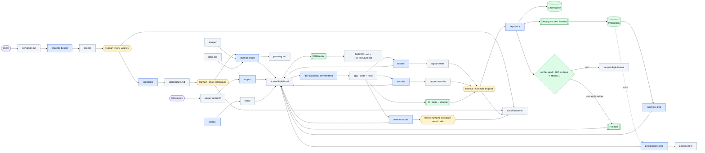

# ARCHITECTURE — le « comment » de l'ESN virtuelle

> Ce document décrit l'architecture **du système multi-agents**, pas celle d'un projet client.
> L'architecture d'un projet client se trouve dans `projets/<slug>/architecture.md`.
> Vision : [VISION.md](VISION.md) · Règles du coordinateur : [CLAUDE.md](../CLAUDE.md) · Décisions : [decisions/](decisions/)

## 1. Objet

L'ESN est un ensemble d'agents spécialisés, orchestrés par un coordinateur unique. Ils travaillent sur des espaces projets isolés et communiquent par des fichiers Markdown versionnés. Les humains valident les étapes clés et modifient les règles.

## 2. Principes techniques

| Brique | Rôle | Emplacement |
|---|---|---|
| Claude Code, session principale | Coordinateur | `CLAUDE.md` |
| Subagents Claude Code | Agents spécialisés | `.claude/agents/*.md` |
| Skills | Procédures réutilisables (ticket, avancement, événements…) | `.claude/skills/<nom>/SKILL.md` |
| Hooks et permissions | Validations humaines appliquées techniquement | `.claude/settings.json`, `.claude/hooks/` |
| Templates | Format de chaque livrable | `templates/` |
| Runbooks | Procédures de crise | `runbooks/` |
| Scripts Python | Tableaux de bord, contrôles | `scripts/` |
| GitHub Actions | Tests, sécurité, déploiement, tableaux, contrôle des validations | `.github/workflows/` |
| Render | Hébergement par défaut des apps clientes | voir § 9 |

## 3. Arborescence

Légende : `(A)`, `(B)`, `(C)` ou `(D)` désigne le responsable ; `[gén.]` signale un fichier généré, à ne jamais modifier à la main.

```
/
├── CLAUDE.md                         (B) coordinateur
├── README.md
├── PORTFOLIO.md                      [gén.] vue de tous les projets
├── .gitattributes                    fins de ligne LF
├── .claude/
│   ├── settings.json                 (C) permissions ask/deny + déclaration des hooks
│   ├── hooks/proteger_valide.py      (C) hook PreToolUse (voir § 6)
│   ├── agents/*.md                   catalogue (§ 4)
│   └── skills/
│       ├── creer-ticket/  avancement/  nouveau-projet/  tracer-decision/        (B)
│       ├── arrivee-membre/  depart-membre/  absence/  revision-budget/          (B)
│       └── verifier-prod/                                                       (C)
├── .github/workflows/
│   ├── ci.yml  securite.yml          (C) filtrés par chemin : projets/<slug>/app/**
│   ├── deploy.yml                    (C) sauvegarde → deploy hook Render → verifier-prod → rollback si KO
│   ├── tableau.yml                   (C) régénère TABLEAU/PORTFOLIO
│   └── validations.yml               (C) contrôle VALIDÉ ⇔ valide_par + decision
├── docs/
│   ├── VISION.md  ARCHITECTURE.md  CHANGELOG-REGLES.md
│   ├── systemes/S1..S4-*.md          un fichier par système (responsable du système)
│   └── decisions/                    AAAA-MM-JJ-DEC-NNN-<sujet>.md
├── templates/                        (A) _ENTETE.md + un template par livrable
├── runbooks/                         (D) perte-donnees, coupure-serveur, intrusion, rollback
├── equipe/                           (B) membres/<prenom>.md, agents.md, calendrier.md
├── veille/AAAA-Sxx.md                (D) veille commune à l'ESN
├── scripts/
│   ├── tableau.py  test_tableau.py   (D)
│   └── verifier_validations.py       (C)
└── projets/<slug>/
    ├── demande.md  projet.md  cdc.md  architecture.md  planning.md  retex.md
    ├── tickets/T-NNN-<titre-court>.md
    ├── rapports/                     tests, sécurité, déploiement, post-mortem, logs/métriques simulés
    ├── support/entrant/              remontées utilisateurs (simulées)
    ├── app/                          code de l'application cliente
    └── TABLEAU.md                    [gén.]
```

## 4. Catalogue des agents

Le coordinateur n'est pas un agent. **Aucun agent ne dispose de l'outil `Agent`** (règle R1).

| Agent | Système | Resp. | Rôle | Entrées | Sorties | Outils |
|---|---|---|---|---|---|---|
| `analyste-besoin` | S4 | A | Reformule la demande, détecte les manques, rédige le CDC, analyse l'existant (modernisation) | `demande.md` | `cdc.md` (EN_REVUE), questions au client, ticket ATTENTE_HUMAIN | Read, Glob, Grep, Write, Edit |
| `architecte` | S4 | A | Choisit le SI et la stack (Render par défaut), conçoit l'architecture, fixe les exigences de qualité, sécurité et maintenance | `cdc.md` VALIDÉ | `architecture.md` (EN_REVUE), ticket ATTENTE_HUMAIN | Read, Glob, Grep, Write, Edit, WebSearch |
| `chef-de-projet` | S1 | B | Découpe en tickets, estime, assigne ; trie les tickets S2 et `amelioration` ; suit budget et délais ; repère les besoins de formation et d'amélioration des agents ; analyse l'impact des événements d'équipe | `cdc.md` et `architecture.md` VALIDÉS, `equipe/`, `tickets/`, `retex.md` | `tickets/`, `planning.md`, `projet.md`, `retex.md` | Read, Glob, Grep, Write, Edit, Bash(`python scripts/tableau.py`) |
| `dev-backend` | réalisation | A | Réalise les tickets backend et leurs tests unitaires | ticket prenable, `architecture.md` | code et tests dans `app/`, journal du ticket, ticket EN_REVUE | Read, Glob, Grep, Write, Edit, Bash (tests, git sans push) |
| `dev-frontend` | réalisation | A | Réalise les tickets frontend et leurs tests | idem | idem | idem |
| `relecteur-code` | S3 | C | Revue de qualité et de maintenabilité, **en lecture seule sur le code** | ticket EN_REVUE, diff | section « Revue » du ticket : `APPROUVÉ` ou `CHANGEMENTS_DEMANDÉS` | Read, Glob, Grep, Edit (ticket uniquement), Bash(`git diff`, `git log`) |
| `testeur` | S3 | C | Tests fonctionnels et de régression ; vérifie les critères d'acceptation | ticket EN_REVUE, `app/`, `cdc.md` | `rapports/tests-*.md`, tickets bug, critères cochés | Read, Glob, Grep, Write, Edit (tickets et rapports), Bash (tests) |
| `securite` | S3 | C | Audit OWASP, dépendances, secrets, configuration. **Ne corrige pas le code** | `app/`, `architecture.md` | `rapports/securite-*.md`, tickets bug sécurité | Read, Glob, Grep, Write, Bash (outils d'audit) |
| `deployeur` | S3 | C | Sauvegarde, déclenchement du déploiement après le GO humain, vérification en ligne, rollback | rapports verts, ticket de mise en production débloqué | `rapports/deploiement-*.md`, ticket TERMINE ou incident | Read, Write, Edit, Bash(`gh workflow run`, `curl`) |
| `veilleur` | S2 | D | Veille techno et CVE sur les stacks utilisées | `architecture.md` des projets, web | `veille/AAAA-Sxx.md`, tickets sécurité ou amélioration | Read, Glob, Write, WebSearch, WebFetch |
| `analyste-prod` | S2 | D | Suivi des performances et des bugs après le déploiement | `/health` réel, logs et métriques simulés | tickets bug ou incident, rapport de suivi | Read, Grep, Write, Bash(`curl`) |
| `support` | S2 | D | Qualifie et dédoublonne les remontées utilisateurs, propose une réponse | `support/entrant/` | tickets support ou bug, réponses type | Read, Glob, Grep, Write, Edit |
| `gestionnaire-crise` | S2 | D | Déroule le runbook adapté, coordonne la crise, rédige le post-mortem | alerte ou incident, `runbooks/` | ticket incident critique, ATTENTE_HUMAIN, `rapports/post-mortem-*.md` | Read, Glob, Grep, Write, Edit, Bash (diagnostic) |

**Pôle réalisation.** `dev-backend` et `dev-frontend` sont des agents d'exécution transverses. Ils ne sont rattachés à aucun des 4 systèmes ; ils exécutent les tickets planifiés par S1 et contrôlés par S3.

**Séparation des pouvoirs.** Celui qui écrit le code ne le valide pas. `relecteur-code` et `securite` signalent mais ne corrigent pas. Pourquoi : un contrôle indépendant est le seul qui ait de la valeur.

## 5. Circuit des fichiers



Le coordinateur lance chaque agent. Il est omis du schéma pour le garder lisible.

## 6. Modèle de validation

**Statuts des documents** (en-tête standard, voir [templates/_ENTETE.md](../templates/_ENTETE.md)) : `BROUILLON` → `EN_REVUE` → `VALIDÉ`.
Les tickets ont leur propre cycle de statuts (§ 7), qui ne comporte pas `VALIDÉ`.

**Garde-fous de la validation** (DEC-001, sections 7, 8, 23 et 25) :

| # | Garde-fou | Mécanisme | Lot |
|---|---|---|---|
| 1 | Aucun agent ni le coordinateur n'écrit `statut: VALIDÉ` | hook PreToolUse `proteger_valide.py` sur Write/Edit | settings/hooks |
| 2 | **Un document VALIDÉ est figé pour les agents** : toute écriture sur un fichier dont l'en-tête actuel est `VALIDÉ` est bloquée ; pour le modifier, un humain le repasse en `EN_REVUE` | même hook | settings/hooks |
| 3 | Un document `VALIDÉ` a obligatoirement `valide_par` et `decision: DEC-NNN` | règle R5, templates | Lot 1 |
| 4 | La CI vérifie que chaque `decision` pointe vers un fichier existant de `docs/decisions/` | `validations.yml` + `verifier_validations.py` | workflows |
| 5 | **Normalisation du statut** : le hook et `verifier_validations.py` comparent la valeur après suppression des accents et passage en majuscules (`VALIDE`, `validé`, `Validé` = `VALIDÉ`). La CI **refuse tout statut de document hors `BROUILLON`, `EN_REVUE`, `VALIDÉ`** | hook + `verifier_validations.py` | settings/hooks, workflows |
| 6 | **Templates protégés** : permission `ask` sur `Write(templates/**)` et `Edit(templates/**)` | `.claude/settings.json` | settings/hooks |

Un « document » est ici tout fichier Markdown dont le frontmatter porte l'en-tête standard (champ `valide_par`). Les tickets et les fiches membres, qui ont leur propre format, ne sont pas concernés par les garde-fous 3 à 5.

*Pourquoi le garde-fou 2 :* le hook ne voit que les outils Write et Edit. Un agent pourrait modifier le corps d'un document validé sans toucher au statut, ou passer par Bash. Figer le fichier, avec le contrôle CI comme filet, garantit que le contenu appliqué est bien celui qui a été validé.

*Pourquoi le garde-fou 5 :* sans normalisation, écrire `VALIDE` sans accent contournerait le hook et ferait passer un document pour validé.

*Pourquoi le garde-fou 6 :* les templates restent en `BROUILLON` par nature, donc R6 ne les protège pas ; or `tableau.py` et tous les agents dépendent de leur format.

**Exception, les journaux.** `docs/CHANGELOG-REGLES.md` et `docs/decisions/README.md` ne passent jamais `VALIDÉ` : ils restent en `EN_REVUE`, évoluent uniquement par PR et sont exclus de R6 (garde-fou 2). *Pourquoi :* un journal figé empêcherait de tracer les décisions suivantes.

**Les humains valident** en modifiant eux-mêmes le fichier dans leur éditeur, pas via Claude. Ils remplissent l'en-tête et créent le fichier de décision.

## 7. Ticketing (résumé)

Format complet : [templates/ticket.md](../templates/ticket.md). Règles détaillées : [S1](systemes/S1-gestion-projet.md).

- **Types** : `fonctionnalite`, `tache`, `bug`, `incident`, `support`, `decision`, `formation`, `amelioration`.
- **Statuts** : `A_FAIRE`, `EN_COURS`, `EN_REVUE`, `BLOQUE`, `ATTENTE_HUMAIN`, `TERMINE`, `ANNULE`.
- **Un ticket `decision` porte l'attente, le fichier de `docs/decisions/` porte la trace.** Ils sont liés par l'id (`decision: DEC-NNN` dans le ticket, `ticket: T-NNN` dans la décision).

**Formules du tableau de bord** (`scripts/tableau.py`) :
- Avancement = Σ estimation des tickets TERMINE ÷ Σ estimation des tickets hors ANNULE.
- **Temps restant = Σ max(0, estimation_h − temps_passe_h)** sur les tickets qui ne sont ni TERMINE ni ANNULE.
- Capacité d'un salarié sur une période = heures/semaine × allocation au projet (%) × jours disponibles (d'après `equipe/calendrier.md`).
- Budget consommé = Σ temps_passe_h × taux horaire de l'assigné (§ 8).

**Alertes** : deadline dépassée en projection ; budget consommé supérieur à 90 % ; ticket critique ouvert ; ticket EN_COURS sans mise à jour depuis plus de **2 jours ouvrés** ; préavis de départ inférieur à **5 jours ouvrés**.

**Régénération** : `tableau.yml` commite TABLEAU/PORTFOLIO **seulement s'il y a des changements**, avec `[skip ci]` et un groupe `concurrency`. En cas de conflit, on régénère au lieu de résoudre à la main.

## 8. Unités et coûts

| Paramètre | Valeur | Pourquoi |
|---|---|---|
| Journée | **7 h** | convention usuelle en ESN ; elle permet de convertir le coût journalier en taux horaire |
| Unité des temps | **heures équivalent humain**, quel que soit l'assigné | estimations comparables ; réaffectation agent ↔ salarié sans ré-estimation |
| Salarié débutant | 350 €/j soit 50,00 €/h | grille indicative d'une ESN régionale |
| Salarié confirmé | 450 €/j soit 64,29 €/h | idem |
| Salarié expert | 550 €/j soit 78,57 €/h | idem |
| Agent IA | **15 €/h fictifs** | voir ci-dessous |

**Justification des 15 €/h agent.** Une heure équivalent humain produite par un agent coûte :
- (a) la consommation d'API, de l'ordre de quelques euros ;
- (b) le temps de supervision humaine nécessaire pour lire, valider et corriger, estimé à environ 10 min par heure produite au tarif d'un confirmé, soit environ 11 €.

La somme (a) + (b) donne un ordre de grandeur de 15 €/h. Le chiffre est volontairement fictif et arrondi. Il se révise par une décision humaine (R11) si les mesures réelles s'en écartent.

## 9. Hébergement et vérification en ligne

- **Hébergeur par défaut : Render** (offre gratuite). `deploy.yml` déclenche le déploiement via le **deploy hook** du service, stocké en secret GitHub.
- **Chaque app expose `/health`**, qui renvoie le SHA du commit déployé. Render fournit la variable `RENDER_GIT_COMMIT`.
- **`verifier-prod`** compare ce SHA au commit attendu, **avec des retries et un délai entre eux**, parce que l'offre gratuite met l'app en veille et qu'un build prend plusieurs minutes. Le ticket de déploiement ne passe TERMINE qu'après concordance (R13).
- **Un autre hébergeur** peut être proposé par l'`architecte` selon le projet, avec un ticket `ATTENTE_HUMAIN` et une décision.

## 10. À trancher au lot workflows

Ces points sont identifiés mais volontairement non tranchés au Lot 1 :

| # | Sujet | Proposition actuelle | À décider |
|---|---|---|---|
| 1 | **Délais Render** (build + réveil) | polling de `/health` toutes les 30 s, timeout 15 min | valeurs définitives, comportement au timeout |
| 2 | **Persistance des données et sauvegardes** | disque Render gratuit éphémère, donc pas de SQLite en production ; base Render Postgres gratuite (expire après 30 j, ce qui suffit pour la semaine) ; sauvegarde par `pg_dump` dans `deploy.yml`, stockée en artefact GitHub Actions | base retenue, emplacement et durée de rétention des sauvegardes |
| 3 | **Rollback** | redéployer le SHA précédent via le deploy hook, si le paramètre de commit est supporté (à vérifier) ; à défaut `git revert` puis redéploiement | mécanisme retenu, test du rollback |

## 11. Plan de construction par lots

À chaque lot : création, résumé à l'équipe, arrêt pour validation.

| Lot | Contenu |
|---|---|
| 1 | Socle documentaire : CLAUDE.md, ARCHITECTURE, S1–S4, templates, décisions, changelog |
| 2 | Fichiers d'agents `.claude/agents/` |
| 3 | Skills |
| 4 | `scripts/tableau.py` et ses tests |
| 5 | `settings.json`, hooks, workflows (et les points du § 10) |
| 6 | Projet de démonstration `projets/reservation-salle/` |

L'ordre des lots 2 à 6 est indicatif. L'état d'avancement des lots est suivi dans le [README](../README.md#état-davancement), pour que ce document puisse être validé sans être modifié à chaque lot.

## 12. Répartition des responsabilités

| Personne | Périmètre |
|---|---|
| **A** | `analyste-besoin`, `architecte`, `dev-backend`, `dev-frontend`, `templates/`, S4 |
| **B** | `CLAUDE.md`, `chef-de-projet`, skills de ticketing, équipe et événements, `equipe/`, S1, ce document |
| **C** | `testeur`, `securite`, `relecteur-code`, `deployeur`, `settings.json` et hooks, workflows, sauvegardes et rollback, S3 |
| **D** | `veilleur`, `analyste-prod`, `support`, `gestionnaire-crise`, `runbooks/`, `scripts/tableau.py` et ses tests, S2 |

**Interface entre responsables :** `tableau.py` (D) lit les formats de `templates/ticket.md` et `templates/membre.md` (A). Ces formats sont figés par DEC-001 ; toute modification passe par R11 et doit être signalée à D.
