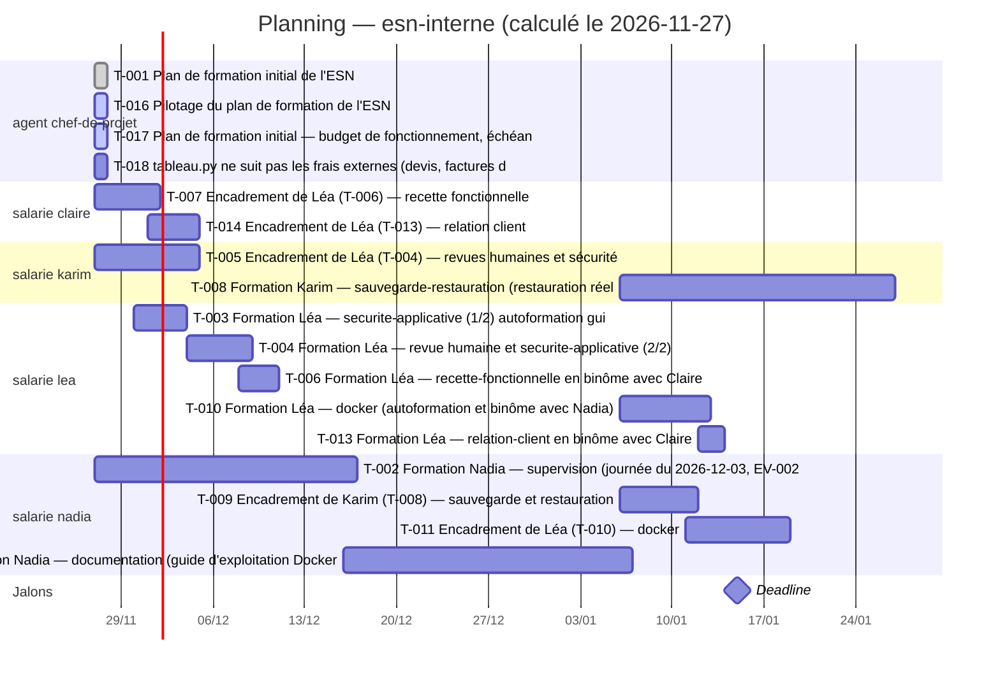

<!-- FICHIER GÉNÉRÉ par scripts/tableau.py — ne pas modifier à la main (R9). Régénérer : python scripts/tableau.py -->

# Tableau de bord — ESN (projet interne) (`esn-interne`)

> **Fichier généré** le 2026-11-27 par `scripts/tableau.py` à partir des tickets, seule source de vérité (R9). Toute modification à la main sera écrasée à la prochaine génération.

## Synthèse

| Indicateur | Valeur |
|---|---|
| Type · état | interne · en_cours |
| Avancement (h estimées terminées / h estimées hors ANNULE) | 2,5 % (1,5 h / 59,5 h) |
| Temps restant (Σ max(0, estimation − passé), DEC-001 § 4) | 57,0 h |
| Budget de fonctionnement consommé / prévu (projet interne, R19) | 60,00 € / 4 360,00 € (1,4 %) |
| Coût projeté à terminaison (consommé + reste × taux) | 3 655,71 € |
| Fin projetée | 2027-01-26 |
| Deadline | 2027-01-15 |
| Écart avec la deadline | +7 j ouvrés |

## Alertes

| Type | Détail |
|---|---|
| Délais | fin projetée le 2027-01-26 après la deadline du 2027-01-15 (+7 j ouvrés) (S1-R11) |
| Absence (S1-R9) | T-002 (salarie:nadia) : fenêtre prévue du 2026-11-27 au 2026-12-16 chevauche EV-002 (2026-12-03 → 2026-12-03) |
| Utilisation (info) | claire utilisé à 16,8 % de sa capacité allouée : ajuster l'allocation ? (AF9, indicateur) |
| Utilisation (info) | lea utilisé à 43,3 % de sa capacité allouée : ajuster l'allocation ? (AF9, indicateur) |
| Surcharge | nadia : 19,0 h assignées pour 18,5 h de capacité allouée (102,8 %) |

## Tickets par statut

| Statut | Nombre |
|---|---|
| A_FAIRE | 14 |
| EN_COURS | 2 |
| EN_REVUE | 0 |
| BLOQUE | 0 |
| ATTENTE_HUMAIN | 0 |
| TERMINE | 1 |
| ANNULE | 1 |
| **Total** | 18 |

## Tickets BLOQUE

Aucun ticket bloqué.

## En attente d'une décision humaine (ATTENTE_HUMAIN)

Aucune décision attendue.

## Tickets salariés à faire par un humain (AF11)

| Ticket | Titre | Assigné | Statut | Reste | Fenêtre prévue |
|---|---|---|---|---|---|
| T-002 | Formation Nadia — supervision (journée du 2026-12-03, EV-002) | salarie:nadia | A_FAIRE | 7,0 h | 2026-11-27 → 2026-12-16 |
| T-003 | Formation Léa — securite-applicative (1/2) autoformation guidée | salarie:lea | A_FAIRE | 7,0 h | 2026-11-30 → 2026-12-03 |
| T-004 | Formation Léa — revue humaine et securite-applicative (2/2) revues en double avec Karim | salarie:lea | A_FAIRE | 4,0 h | 2026-12-04 → 2026-12-08 |
| T-005 | Encadrement de Léa (T-004) — revues humaines et sécurité | salarie:karim | A_FAIRE | 2,0 h | 2026-11-27 → 2026-12-04 |
| T-006 | Formation Léa — recette-fonctionnelle en binôme avec Claire | salarie:lea | A_FAIRE | 4,0 h | 2026-12-08 → 2026-12-10 |
| T-007 | Encadrement de Léa (T-006) — recette fonctionnelle | salarie:claire | A_FAIRE | 1,0 h | 2026-11-27 → 2026-12-01 |
| T-008 | Formation Karim — sauvegarde-restauration (restauration réelle en binôme avec Nadia) | salarie:karim | A_FAIRE | 5,0 h | 2027-01-06 → 2027-01-26 |
| T-009 | Encadrement de Karim (T-008) — sauvegarde et restauration | salarie:nadia | A_FAIRE | 2,0 h | 2027-01-06 → 2027-01-11 |
| T-010 | Formation Léa — docker (autoformation et binôme avec Nadia) | salarie:lea | A_FAIRE | 7,0 h | 2027-01-06 → 2027-01-12 |
| T-011 | Encadrement de Léa (T-010) — docker | salarie:nadia | A_FAIRE | 3,0 h | 2027-01-11 → 2027-01-18 |
| T-012 | Formation Nadia — documentation (guide d'exploitation Docker et restauration) | salarie:nadia | A_FAIRE | 7,0 h | 2026-12-16 → 2027-01-06 |
| T-013 | Formation Léa — relation-client en binôme avec Claire | salarie:lea | A_FAIRE | 3,0 h | 2027-01-12 → 2027-01-13 |
| T-014 | Encadrement de Léa (T-013) — relation client | salarie:claire | A_FAIRE | 1,0 h | 2026-12-01 → 2026-12-04 |

## Tickets formation ouverts

| Ticket | Titre | Assigné | Statut | Estimation |
|---|---|---|---|---|
| T-002 | Formation Nadia — supervision (journée du 2026-12-03, EV-002) | salarie:nadia | A_FAIRE | 7,0 h |
| T-003 | Formation Léa — securite-applicative (1/2) autoformation guidée | salarie:lea | A_FAIRE | 7,0 h |
| T-004 | Formation Léa — revue humaine et securite-applicative (2/2) revues en double avec Karim | salarie:lea | A_FAIRE | 4,0 h |
| T-006 | Formation Léa — recette-fonctionnelle en binôme avec Claire | salarie:lea | A_FAIRE | 4,0 h |
| T-008 | Formation Karim — sauvegarde-restauration (restauration réelle en binôme avec Nadia) | salarie:karim | A_FAIRE | 5,0 h |
| T-010 | Formation Léa — docker (autoformation et binôme avec Nadia) | salarie:lea | A_FAIRE | 7,0 h |
| T-012 | Formation Nadia — documentation (guide d'exploitation Docker et restauration) | salarie:nadia | A_FAIRE | 7,0 h |
| T-013 | Formation Léa — relation-client en binôme avec Claire | salarie:lea | A_FAIRE | 3,0 h |

## Utilisation des salariés (AF9, indicateur)

Période : du 2026-11-27 au 2027-01-15. Heures restantes assignées ÷ capacité allouée sur la période (calendrier et jours fériés compris). Sous 50,0 %, proposer d'ajuster l'allocation ; jamais de ticket artificiel.

| Salarié | Allocation | h restantes assignées | Capacité allouée | Utilisation | Observation |
|---|---|---|---|---|---|
| claire | 5 % | 2,0 h | 11,9 h | 16,8 % | sous 50,0 % : ajuster l'allocation ? |
| karim | 5 % | 7,0 h | 9,1 h | 76,9 % | — |
| lea | 25 % | 25,0 h | 57,8 h | 43,3 % | sous 50,0 % : ajuster l'allocation ? |
| nadia | 10 % | 19,0 h | 18,5 h | 102,8 % | surcharge |

## Planning prévisionnel (Gantt)

## Hypothèses de calcul

- Taux : agent 15,00 €/h ; salarié : coût journalier ÷ 7 (ARCHITECTURE § 8). Le budget consommé compte aussi le temps passé sur les tickets ANNULE.
- Ordonnancement à partir du 2026-11-27 : dépendances, puis priorité (critique → basse), puis id ; un ticket à la fois par assigné.
- Capacité : agent 7,0 h par jour ouvré ; salarié capacite_h_semaine ÷ 5 × allocation au projet × capacité restante du calendrier (temps partiel moyenné sur 5 jours) ; nulle avant l'arrivée et après le départ.
- Jours ouvrés : hors samedis, dimanches et jours fériés d'`equipe/calendrier.md`.
- Les tickets BLOQUE et ATTENTE_HUMAIN sont supposés débloqués aujourd'hui ; leur date de fin est donc optimiste.
- Tickets TERMINE dans le Gantt : de `cree_le` à `maj_le` (ou `debut_le` / `termine_le` s'ils existent).
- Projet interne de l'ESN (R19, DEC-023) : tous les tickets sont à la charge de l'ESN et comparés au budget de fonctionnement (`budget_eur`).

## Anomalies de données

Aucune.
