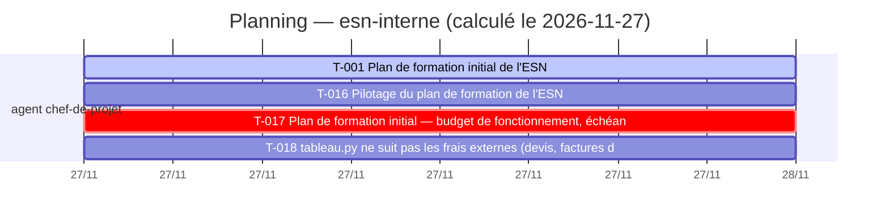

<!-- FICHIER GÉNÉRÉ par scripts/tableau.py — ne pas modifier à la main (R9). Régénérer : python scripts/tableau.py -->

# Tableau de bord — ESN (projet interne) (`esn-interne`)

> **Fichier généré** le 2026-11-27 par `scripts/tableau.py` à partir des tickets, seule source de vérité (R9). Toute modification à la main sera écrasée à la prochaine génération.

## Synthèse

| Indicateur | Valeur |
|---|---|
| Type · état | interne · cadrage |
| Avancement (h estimées terminées / h estimées hors ANNULE) | 0,0 % (0,0 h / 66,5 h) |
| Temps restant (Σ max(0, estimation − passé), DEC-001 § 4) | 65,0 h |
| Budget de fonctionnement consommé / prévu (projet interne, R19) | 45,00 € / non renseigné |
| Coût projeté à terminaison (consommé + reste × taux) | 4 205,71 € |
| Fin projetée | 2026-11-27 (hors 14 ticket(s) non planifiable(s)) |
| Deadline | non renseignée |
| Écart avec la deadline | — |

## Alertes

| Type | Détail |
|---|---|
| Non planifiable | T-002 : salarie:nadia : allocation au projet nulle (S1-R10) |
| Non planifiable | T-003 : salarie:lea : allocation au projet nulle (S1-R10) |
| Non planifiable | T-004 : dépend de T-003 non planifiable |
| Non planifiable | T-005 : salarie:karim : allocation au projet nulle (S1-R10) |
| Non planifiable | T-006 : salarie:lea : allocation au projet nulle (S1-R10) |
| Non planifiable | T-007 : salarie:claire : allocation au projet nulle (S1-R10) |
| Non planifiable | T-008 : dépend de T-012 non planifiable |
| Non planifiable | T-009 : dépend de T-012 non planifiable |
| Non planifiable | T-010 : dépend de T-012 non planifiable |
| Non planifiable | T-011 : dépend de T-012 non planifiable |
| Non planifiable | T-012 : salarie:nadia : allocation au projet nulle (S1-R10) |
| Non planifiable | T-013 : salarie:lea : allocation au projet nulle (S1-R10) |
| Non planifiable | T-014 : salarie:claire : allocation au projet nulle (S1-R10) |
| Non planifiable | T-015 : salarie:claire : allocation au projet nulle (S1-R10) |

## Tickets par statut

| Statut | Nombre |
|---|---|
| A_FAIRE | 16 |
| EN_COURS | 0 |
| EN_REVUE | 1 |
| BLOQUE | 0 |
| ATTENTE_HUMAIN | 1 |
| TERMINE | 0 |
| ANNULE | 0 |
| **Total** | 18 |

## Tickets BLOQUE

Aucun ticket bloqué.

## En attente d'une décision humaine (ATTENTE_HUMAIN)

| Priorité | Ticket | Titre | Porteur | Question (bloque_par) | Ancienneté |
|---|---|---|---|---|---|
| haute | T-017 | Plan de formation initial — budget de fonctionnement, échéance et allocations (DEC-024) | agent:chef-de-projet | décision humaine sur le plan de formation initial de l'ESN (formations retenues, budget de fonctionnement, échéance, allocations à esn-interne), DEC-024 | 0 j ouvré |

## Tickets salariés à faire par un humain (AF11)

| Ticket | Titre | Assigné | Statut | Reste | Fenêtre prévue |
|---|---|---|---|---|---|
| T-002 | Formation Nadia — supervision (journée du 2026-12-03, EV-002) | salarie:nadia | A_FAIRE | 7,0 h | non planifiable |
| T-003 | Formation Léa — securite-applicative (1/2) autoformation guidée | salarie:lea | A_FAIRE | 7,0 h | non planifiable |
| T-004 | Formation Léa — revue humaine et securite-applicative (2/2) revues en double avec Karim | salarie:lea | A_FAIRE | 4,0 h | non planifiable |
| T-005 | Encadrement de Léa (T-004) — revues humaines et sécurité | salarie:karim | A_FAIRE | 2,0 h | non planifiable |
| T-006 | Formation Léa — recette-fonctionnelle en binôme avec Claire | salarie:lea | A_FAIRE | 4,0 h | non planifiable |
| T-007 | Encadrement de Léa (T-006) — recette fonctionnelle | salarie:claire | A_FAIRE | 1,0 h | non planifiable |
| T-008 | Formation Karim — sauvegarde-restauration (restauration réelle en binôme avec Nadia) | salarie:karim | A_FAIRE | 5,0 h | non planifiable |
| T-009 | Encadrement de Karim (T-008) — sauvegarde et restauration | salarie:nadia | A_FAIRE | 2,0 h | non planifiable |
| T-010 | Formation Léa — docker (autoformation et binôme avec Nadia) | salarie:lea | A_FAIRE | 7,0 h | non planifiable |
| T-011 | Encadrement de Léa (T-010) — docker | salarie:nadia | A_FAIRE | 3,0 h | non planifiable |
| T-012 | Formation Nadia — documentation (guide d'exploitation Docker et restauration) | salarie:nadia | A_FAIRE | 7,0 h | non planifiable |
| T-013 | Formation Léa — relation-client en binôme avec Claire | salarie:lea | A_FAIRE | 3,0 h | non planifiable |
| T-014 | Encadrement de Léa (T-013) — relation client | salarie:claire | A_FAIRE | 1,0 h | non planifiable |
| T-015 | Formation Claire — juridique (RGPD du sous-traitant, contrats, violations) | salarie:claire | A_FAIRE | 7,0 h | non planifiable |

## Tickets formation ouverts

| Ticket | Titre | Assigné | Statut | Estimation |
|---|---|---|---|---|
| T-002 | Formation Nadia — supervision (journée du 2026-12-03, EV-002) | salarie:nadia | A_FAIRE | 7,0 h |
| T-003 | Formation Léa — securite-applicative (1/2) autoformation guidée | salarie:lea | A_FAIRE | 7,0 h |
| T-004 | Formation Léa — revue humaine et securite-applicative (2/2) revues en double avec Karim | salarie:lea | A_FAIRE | 4,0 h |
| T-006 | Formation Léa — recette-fonctionnelle en binôme avec Claire | salarie:lea | A_FAIRE | 4,0 h |
| T-008 | Formation Karim — sauvegarde-restauration (restauration réelle en binôme avec Nadia) | salarie:karim | A_FAIRE | 5,0 h |
| T-010 | Formation Léa — docker (autoformation et binôme avec Nadia) | salarie:lea | A_FAIRE | 7,0 h |
| T-012 | Formation Nadia — documentation (guide d'exploitation Docker et restauration) | salarie:nadia | A_FAIRE | 7,0 h |
| T-013 | Formation Léa — relation-client en binôme avec Claire | salarie:lea | A_FAIRE | 3,0 h |
| T-015 | Formation Claire — juridique (RGPD du sous-traitant, contrats, violations) | salarie:claire | A_FAIRE | 7,0 h |

## Utilisation des salariés (AF9, indicateur)

Période : du 2026-11-27 au 2026-11-27. Heures restantes assignées ÷ capacité allouée sur la période (calendrier et jours fériés compris). Sous 50,0 %, proposer d'ajuster l'allocation ; jamais de ticket artificiel.

| Salarié | Allocation | h restantes assignées | Capacité allouée | Utilisation | Observation |
|---|---|---|---|---|---|
| claire | 0 % | 9,0 h | 0,0 h | — | allocation au projet nulle (S1-R10) |
| karim | 0 % | 7,0 h | 0,0 h | — | allocation au projet nulle (S1-R10) |
| lea | 0 % | 25,0 h | 0,0 h | — | allocation au projet nulle (S1-R10) |
| nadia | 0 % | 19,0 h | 0,0 h | — | allocation au projet nulle (S1-R10) |

## Planning prévisionnel (Gantt)

## Hypothèses de calcul

- Taux : agent 15,00 €/h ; salarié : coût journalier ÷ 7 (ARCHITECTURE § 8). Le budget consommé compte aussi le temps passé sur les tickets ANNULE.
- Ordonnancement à partir du 2026-11-27 : dépendances, puis priorité (critique → basse), puis id ; un ticket à la fois par assigné.
- Capacité : agent 7,0 h par jour ouvré ; salarié capacite_h_semaine ÷ 5 × allocation au projet × capacité restante du calendrier (temps partiel moyenné sur 5 jours) ; nulle avant l'arrivée et après le départ.
- Jours ouvrés : hors samedis, dimanches et jours fériés d'`equipe/calendrier.md`.
- Les tickets BLOQUE et ATTENTE_HUMAIN sont supposés débloqués aujourd'hui ; leur date de fin est donc optimiste.
- Tickets TERMINE dans le Gantt : de `cree_le` à `maj_le` (ou `debut_le` / `termine_le` s'ils existent).
- Projet interne de l'ESN (R19, DEC-023) : tous les tickets sont à la charge de l'ESN et comparés au budget de fonctionnement (`budget_eur`).

## Anomalies de données

- projet.md : budget_eur absent ou nul ; pas de contrôle budgétaire
- projet.md : deadline absente ou invalide ; pas de contrôle des délais
