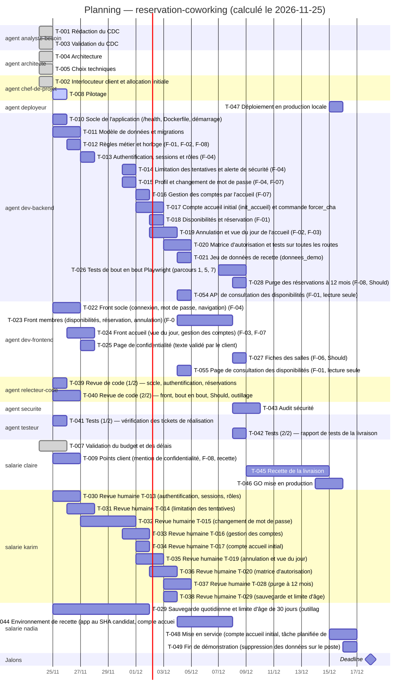

<!-- FICHIER GÉNÉRÉ par scripts/tableau.py — ne pas modifier à la main (R9). Régénérer : python scripts/tableau.py -->

# Tableau de bord — Coworking Les Arcades (Perpignan) (`reservation-coworking`)

> **Fichier généré** le 2026-11-25 par `scripts/tableau.py` à partir des tickets, seule source de vérité (R9). Toute modification à la main sera écrasée à la prochaine génération.

## Synthèse

| Indicateur | Valeur |
|---|---|
| Type · état | metier · cadrage |
| Avancement (h estimées terminées / h estimées hors ANNULE) | 10,4 % (16,0 h / 154,5 h) |
| Temps restant (Σ max(0, estimation − passé), DEC-001 § 4) | 133,5 h |
| Budget consommé / prévu | 367,50 € / 6 000,00 € (6,1 %) |
| Coût projeté à terminaison (consommé + reste × taux) | 3 700,36 € |
| Fin projetée | 2026-12-16 |
| Deadline | 2026-12-18 |
| Écart avec la deadline | -2 j ouvrés |

## Alertes

| Type | Détail |
|---|---|
| Utilisation (info) | claire utilisé à 31,7 % de sa capacité allouée : ajuster l'allocation ? (AF9, indicateur) |
| Utilisation (info) | karim utilisé à 39,7 % de sa capacité allouée : ajuster l'allocation ? (AF9, indicateur) |
| Utilisation (info) | nadia utilisé à 36,8 % de sa capacité allouée : ajuster l'allocation ? (AF9, indicateur) |

## Tickets par statut

| Statut | Nombre |
|---|---|
| A_FAIRE | 43 |
| EN_COURS | 1 |
| EN_REVUE | 0 |
| BLOQUE | 0 |
| ATTENTE_HUMAIN | 0 |
| TERMINE | 6 |
| ANNULE | 5 |
| **Total** | 55 |

## Tickets BLOQUE

Aucun ticket bloqué.

## En attente d'une décision humaine (ATTENTE_HUMAIN)

Aucune décision attendue.

## Tickets salariés à faire par un humain (AF11)

| Ticket | Titre | Assigné | Statut | Reste | Fenêtre prévue |
|---|---|---|---|---|---|
| T-009 | Points client (mention de confidentialité, F-08, recette) | salarie:claire | A_FAIRE | 2,5 h | 2026-11-25 → 2026-11-26 |
| T-029 | Sauvegarde quotidienne et limite d'âge de 30 jours (outillage) | salarie:nadia | A_FAIRE | 4,5 h | 2026-11-25 → 2026-12-01 |
| T-030 | Revue humaine T-013 (authentification, sessions, rôles) | salarie:karim | A_FAIRE | 1,5 h | 2026-11-25 → 2026-11-26 |
| T-031 | Revue humaine T-014 (limitation des tentatives) | salarie:karim | A_FAIRE | 1,0 h | 2026-11-26 → 2026-11-27 |
| T-032 | Revue humaine T-015 (changement de mot de passe) | salarie:karim | A_FAIRE | 1,0 h | 2026-11-27 → 2026-11-30 |
| T-033 | Revue humaine T-016 (gestion des comptes) | salarie:karim | A_FAIRE | 1,0 h | 2026-11-30 → 2026-12-01 |
| T-034 | Revue humaine T-017 (compte accueil initial) | salarie:karim | A_FAIRE | 0,5 h | 2026-12-01 → 2026-12-01 |
| T-035 | Revue humaine T-019 (annulation et vue du jour) | salarie:karim | A_FAIRE | 0,5 h | 2026-12-01 → 2026-12-02 |
| T-036 | Revue humaine T-020 (matrice d'autorisation) | salarie:karim | A_FAIRE | 1,0 h | 2026-12-02 → 2026-12-03 |
| T-037 | Revue humaine T-028 (purge à 12 mois) | salarie:karim | A_FAIRE | 0,5 h | 2026-12-03 → 2026-12-04 |
| T-038 | Revue humaine T-029 (sauvegarde et limite d'âge) | salarie:karim | A_FAIRE | 0,5 h | 2026-12-03 → 2026-12-03 |
| T-044 | Environnement de recette (app au SHA candidat, compte accueil de recette) | salarie:nadia | A_FAIRE | 1,0 h | 2026-12-04 → 2026-12-07 |
| T-045 | Recette de la livraison | salarie:claire | A_FAIRE | 5,0 h | 2026-12-09 → 2026-12-14 |
| T-046 | GO mise en production | salarie:claire | A_FAIRE | 0,5 h | 2026-12-14 → 2026-12-15 |
| T-048 | Mise en service (compte accueil initial, tâche planifiée de sauvegarde) | salarie:nadia | A_FAIRE | 1,0 h | 2026-12-15 → 2026-12-16 |
| T-049 | Fin de démonstration (suppression des données sur le poste) | salarie:nadia | A_FAIRE | 0,5 h | 2026-12-16 → 2026-12-16 |

## Tickets formation ouverts

Aucun.

## Utilisation des salariés (AF9, indicateur)

Période : du 2026-11-25 au 2026-12-18. Heures restantes assignées ÷ capacité allouée sur la période (calendrier et jours fériés compris). Sous 50,0 %, proposer d'ajuster l'allocation ; jamais de ticket artificiel.

| Salarié | Allocation | h restantes assignées | Capacité allouée | Utilisation | Observation |
|---|---|---|---|---|---|
| claire | 20 % | 8,0 h | 25,2 h | 31,7 % | sous 50,0 % : ajuster l'allocation ? |
| karim | 15 % | 7,5 h | 18,9 h | 39,7 % | sous 50,0 % : ajuster l'allocation ? |
| nadia | 20 % | 7,0 h | 19,0 h | 36,8 % | sous 50,0 % : ajuster l'allocation ? |

## Planning prévisionnel (Gantt)

## Hypothèses de calcul

- Taux : agent 15,00 €/h ; salarié : coût journalier ÷ 7 (ARCHITECTURE § 8). Le budget consommé compte aussi le temps passé sur les tickets ANNULE.
- Ordonnancement à partir du 2026-11-25 : dépendances, puis priorité (critique → basse), puis id ; un ticket à la fois par assigné.
- Capacité : agent 7,0 h par jour ouvré ; salarié capacite_h_semaine ÷ 5 × allocation au projet × capacité restante du calendrier (temps partiel moyenné sur 5 jours) ; nulle avant l'arrivée et après le départ.
- Jours ouvrés : hors samedis, dimanches et jours fériés d'`equipe/calendrier.md`.
- Les tickets BLOQUE et ATTENTE_HUMAIN sont supposés débloqués aujourd'hui ; leur date de fin est donc optimiste.
- Tickets TERMINE dans le Gantt : de `cree_le` à `maj_le` (ou `debut_le` / `termine_le` s'ils existent).

## Anomalies de données

Aucune.
