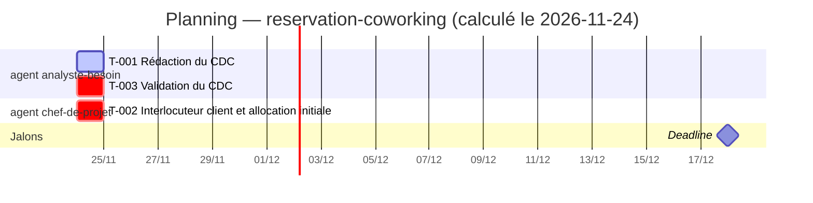

<!-- FICHIER GÉNÉRÉ par scripts/tableau.py — ne pas modifier à la main (R9). Régénérer : python scripts/tableau.py -->

# Tableau de bord — Espace de coworking (Perpignan) (`reservation-coworking`)

> **Fichier généré** le 2026-11-24 par `scripts/tableau.py` à partir des tickets, seule source de vérité (R9). Toute modification à la main sera écrasée à la prochaine génération.

## Synthèse

| Indicateur | Valeur |
|---|---|
| Type · état | metier · cadrage |
| Avancement (h estimées terminées / h estimées hors ANNULE) | 0,0 % (0,0 h / 8,0 h) |
| Temps restant (Σ max(0, estimation − passé), DEC-001 § 4) | 1,0 h |
| Budget consommé / prévu | 120,00 € / 6 000,00 € (2,0 %) |
| Coût projeté à terminaison (consommé + reste × taux) | 135,00 € |
| Fin projetée | 2026-11-24 |
| Deadline | 2026-12-18 |
| Écart avec la deadline | -18 j ouvrés |

## Alertes

Aucune alerte.

## Tickets par statut

| Statut | Nombre |
|---|---|
| A_FAIRE | 0 |
| EN_COURS | 0 |
| EN_REVUE | 1 |
| BLOQUE | 0 |
| ATTENTE_HUMAIN | 2 |
| TERMINE | 0 |
| ANNULE | 0 |
| **Total** | 3 |

## Tickets BLOQUE

Aucun ticket bloqué.

## En attente d'une décision humaine (ATTENTE_HUMAIN)

| Priorité | Ticket | Titre | Porteur | Question (bloque_par) | Ancienneté |
|---|---|---|---|---|---|
| haute | T-002 | Interlocuteur client et allocation initiale | agent:chef-de-projet | décision humaine sur l'interlocuteur client et son allocation au projet (AF1, S1-R10) | 0 j ouvré |
| haute | T-003 | Validation du CDC | agent:analyste-besoin | validation humaine du CDC v0.4 et de DEC-006 | 0 j ouvré |

## Tickets salariés à faire par un humain (AF11)

Aucun.

## Tickets formation ouverts

Aucun.

## Utilisation des salariés (AF9, indicateur)

Aucun salarié alloué ni assigné.

## Planning prévisionnel (Gantt)

## Hypothèses de calcul

- Taux : agent 15,00 €/h ; salarié : coût journalier ÷ 7 (ARCHITECTURE § 8). Le budget consommé compte aussi le temps passé sur les tickets ANNULE.
- Ordonnancement à partir du 2026-11-24 : dépendances, puis priorité (critique → basse), puis id ; un ticket à la fois par assigné.
- Capacité : agent 7,0 h par jour ouvré ; salarié capacite_h_semaine ÷ 5 × allocation au projet × capacité restante du calendrier (temps partiel moyenné sur 5 jours) ; nulle avant l'arrivée et après le départ.
- Jours ouvrés : hors samedis, dimanches et jours fériés d'`equipe/calendrier.md`.
- Les tickets BLOQUE et ATTENTE_HUMAIN sont supposés débloqués aujourd'hui ; leur date de fin est donc optimiste.
- Tickets TERMINE dans le Gantt : de `cree_le` à `maj_le` (ou `debut_le` / `termine_le` s'ils existent).

## Anomalies de données

Aucune.
