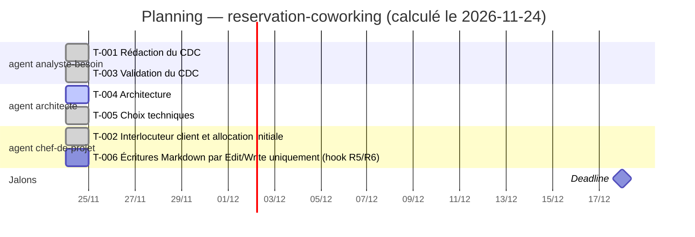

<!-- FICHIER GÉNÉRÉ par scripts/tableau.py — ne pas modifier à la main (R9). Régénérer : python scripts/tableau.py -->

# Tableau de bord — Coworking Les Arcades (Perpignan) (`reservation-coworking`)

> **Fichier généré** le 2026-11-24 par `scripts/tableau.py` à partir des tickets, seule source de vérité (R9). Toute modification à la main sera écrasée à la prochaine génération.

## Synthèse

| Indicateur | Valeur |
|---|---|
| Type · état | metier · cadrage |
| Avancement (h estimées terminées / h estimées hors ANNULE) | 45,9 % (8,5 h / 18,5 h) |
| Temps restant (Σ max(0, estimation − passé), DEC-001 § 4) | 3,0 h |
| Budget consommé / prévu | 270,00 € / 6 000,00 € (4,5 %) |
| Coût projeté à terminaison (consommé + reste × taux) | 315,00 € |
| Fin projetée | 2026-11-24 |
| Deadline | 2026-12-18 |
| Écart avec la deadline | -18 j ouvrés |

## Alertes

| Type | Détail |
|---|---|
| Utilisation (info) | claire utilisé à 0,0 % de sa capacité allouée : ajuster l'allocation ? (AF9, indicateur) |

## Tickets par statut

| Statut | Nombre |
|---|---|
| A_FAIRE | 1 |
| EN_COURS | 0 |
| EN_REVUE | 1 |
| BLOQUE | 0 |
| ATTENTE_HUMAIN | 0 |
| TERMINE | 4 |
| ANNULE | 0 |
| **Total** | 6 |

## Tickets BLOQUE

Aucun ticket bloqué.

## En attente d'une décision humaine (ATTENTE_HUMAIN)

Aucune décision attendue.

## Tickets salariés à faire par un humain (AF11)

Aucun.

## Tickets formation ouverts

Aucun.

## Utilisation des salariés (AF9, indicateur)

Période : du 2026-11-24 au 2026-12-18. Heures restantes assignées ÷ capacité allouée sur la période (calendrier et jours fériés compris). Sous 50,0 %, proposer d'ajuster l'allocation ; jamais de ticket artificiel.

| Salarié | Allocation | h restantes assignées | Capacité allouée | Utilisation | Observation |
|---|---|---|---|---|---|
| claire | 10 % | 0,0 h | 13,3 h | 0,0 % | sous 50,0 % : ajuster l'allocation ? |

## Planning prévisionnel (Gantt)

## Hypothèses de calcul

- Taux : agent 15,00 €/h ; salarié : coût journalier ÷ 7 (ARCHITECTURE § 8). Le budget consommé compte aussi le temps passé sur les tickets ANNULE.
- Ordonnancement à partir du 2026-11-24 : dépendances, puis priorité (critique → basse), puis id ; un ticket à la fois par assigné.
- Capacité : agent 7,0 h par jour ouvré ; salarié capacite_h_semaine ÷ 5 × allocation au projet × capacité restante du calendrier (temps partiel moyenné sur 5 jours) ; nulle avant l'arrivée et après le départ.
- Jours ouvrés : hors samedis, dimanches et jours fériés d'`equipe/calendrier.md`.
- Les tickets BLOQUE et ATTENTE_HUMAIN sont supposés débloqués aujourd'hui ; leur date de fin est donc optimiste.
- Tickets TERMINE dans le Gantt : de `cree_le` à `maj_le` (ou `debut_le` / `termine_le` s'ils existent).

## Anomalies de données

Aucune.
