<!-- FICHIER GÉNÉRÉ par scripts/tableau.py — ne pas modifier à la main (R9). Régénérer : python scripts/tableau.py -->

# Tableau de bord — Coworking Les Arcades (Perpignan) (`reservation-coworking`)

> **Fichier généré** le 2026-11-26 par `scripts/tableau.py` à partir des tickets, seule source de vérité (R9). Toute modification à la main sera écrasée à la prochaine génération.

## Synthèse

| Indicateur | Valeur |
|---|---|
| Type · état | metier · cadrage |
| Avancement (h estimées terminées / h estimées hors ANNULE) | 17,2 % (36,5 h / 212,6 h) |
| Temps restant (Σ max(0, estimation − passé), DEC-001 § 4) | 132,4 h |
| Budget consommé / prévu | 1 393,79 € / 4 200,00 € (33,2 %) |
| Coût projeté à terminaison (consommé + reste × taux) | 5 946,07 € |
| Fin projetée | 2026-12-16 |
| Deadline | 2026-12-18 |
| Écart avec la deadline | -2 j ouvrés |

## Alertes

| Type | Détail |
|---|---|
| Critique | T-029 « Sauvegarde quotidienne et limite d'âge de 30 jours (outillage) » est ouvert (A_FAIRE) |
| Critique | T-080 « SIMULATION — Perte de la base de production (volume Docker supprimé) » est ouvert (EN_REVUE) |
| Critique | T-081 « SIMULATION — Décision restauration de la base de production (T-080) » est ouvert (ATTENTE_HUMAIN) |
| Critique | T-083 « SIMULATION — Décision communication au client sur la perte de données (T-080) » est ouvert (ATTENTE_HUMAIN) |
| Utilisation (info) | claire utilisé à 39,9 % de sa capacité allouée : ajuster l'allocation ? (AF9, indicateur) |

## Tickets par statut

| Statut | Nombre |
|---|---|
| A_FAIRE | 61 |
| EN_COURS | 6 |
| EN_REVUE | 6 |
| BLOQUE | 0 |
| ATTENTE_HUMAIN | 7 |
| TERMINE | 16 |
| ANNULE | 10 |
| **Total** | 106 |

## Tickets BLOQUE

Aucun ticket bloqué.

## En attente d'une décision humaine (ATTENTE_HUMAIN)

| Priorité | Ticket | Titre | Porteur | Question (bloque_par) | Ancienneté |
|---|---|---|---|---|---|
| critique | T-081 | SIMULATION — Décision restauration de la base de production (T-080) | salarie:nadia | décision humaine requise (S2-R4, restauration de données) ; préalable, vérification physique des dossiers de sauvegardes par Nadia | 0 j ouvré |
| critique | T-083 | SIMULATION — Décision communication au client sur la perte de données (T-080) | salarie:claire | décision humaine requise (S2-R4 et AF1, communication au client) ; le message 2 attend aussi la décision T-081 | 0 j ouvré |
| haute | T-057 | Rôle PostgreSQL de l'application (constat 10, moindre privilège) | salarie:karim | décision humaine sur le rôle PostgreSQL de l'application (constat 10 du rapport securite-2026-11-25-3), avec l'accord de C sur le modèle commun | 1 j ouvré |
| haute | T-093 | SIMULATION — Révision du budget : 6 000 € → 4 200 € HT | agent:chef-de-projet | arbitrage humain du scénario de budget (S1-R11) | 0 j ouvré |
| haute | T-103 | SIMULATION — Départ de Hugo : plan de passation | agent:chef-de-projet | décision humaine sur le plan de passation du départ de Hugo (EV-004) | 0 j ouvré |
| haute | T-106 | SIMULATION — Condition 1 de DEC-020 : dépassement prévisible dû au bug T-105 | salarie:claire | arbitrage humain avant d'engager le correctif de T-105 (condition 1 de DEC-020) | 0 j ouvré |
| normale | T-102 | SIMULATION — Absence de Léa du 2026-11-26 au 2026-11-27 | agent:chef-de-projet | décision humaine sur l'absence de Léa (EV-001) | 0 j ouvré |

## Tickets salariés à faire par un humain (AF11)

| Ticket | Titre | Assigné | Statut | Reste | Fenêtre prévue |
|---|---|---|---|---|---|
| T-009 | Points client (mention de confidentialité, F-08, recette) | salarie:claire | A_FAIRE | 2,0 h | 2026-11-26 → 2026-11-30 |
| T-029 | Sauvegarde quotidienne et limite d'âge de 30 jours (outillage) | salarie:nadia | A_FAIRE | 4,5 h | 2026-11-26 → 2026-11-27 |
| T-030 | Revue humaine T-013 (authentification, sessions, rôles) | salarie:karim | A_FAIRE | 1,5 h | 2026-11-26 → 2026-11-27 |
| T-031 | Revue humaine T-014 (limitation des tentatives) | salarie:karim | A_FAIRE | 1,0 h | 2026-11-27 → 2026-11-27 |
| T-032 | Revue humaine T-015 (changement de mot de passe) | salarie:karim | A_FAIRE | 1,0 h | 2026-11-27 → 2026-11-30 |
| T-033 | Revue humaine T-016 (gestion des comptes) | salarie:karim | A_FAIRE | 1,0 h | 2026-11-30 → 2026-12-01 |
| T-034 | Revue humaine T-017 (compte accueil initial) | salarie:karim | A_FAIRE | 0,5 h | 2026-12-01 → 2026-12-01 |
| T-035 | Revue humaine T-019 (annulation et vue du jour) | salarie:karim | A_FAIRE | 0,5 h | 2026-12-01 → 2026-12-01 |
| T-036 | Revue humaine T-020 (matrice d'autorisation) | salarie:karim | A_FAIRE | 1,0 h | 2026-12-01 → 2026-12-02 |
| T-037 | Revue humaine T-028 (purge à 12 mois) | salarie:karim | A_FAIRE | 0,5 h | 2026-12-09 → 2026-12-09 |
| T-038 | Revue humaine T-029 (sauvegarde et limite d'âge) | salarie:karim | A_FAIRE | 0,5 h | 2026-12-02 → 2026-12-02 |
| T-044 | Environnement de recette (app au SHA candidat, compte accueil de recette) | salarie:nadia | A_FAIRE | 1,0 h | 2026-12-04 → 2026-12-07 |
| T-045 | Recette de la livraison | salarie:claire | A_FAIRE | 4,8 h | 2026-12-09 → 2026-12-15 |
| T-046 | GO mise en production | salarie:claire | A_FAIRE | 0,5 h | 2026-12-15 → 2026-12-15 |
| T-048 | Mise en service (compte accueil initial, tâche planifiée de sauvegarde) | salarie:nadia | A_FAIRE | 1,0 h | 2026-12-15 → 2026-12-16 |
| T-049 | Fin de démonstration (suppression des données sur le poste) | salarie:nadia | A_FAIRE | 0,5 h | 2026-12-16 → 2026-12-16 |
| T-057 | Rôle PostgreSQL de l'application (constat 10, moindre privilège) | salarie:karim | ATTENTE_HUMAIN | 0,5 h | 2026-12-03 → 2026-12-03 |
| T-058 | Rôle PostgreSQL applicatif non superutilisateur (constat 10) | salarie:nadia | A_FAIRE | 2,0 h | 2026-12-04 → 2026-12-04 |
| T-059 | Revue humaine T-058 (rôle PostgreSQL applicatif) | salarie:karim | A_FAIRE | 0,5 h | 2026-12-03 → 2026-12-03 |
| T-064 | Revue humaine T-063 (en-têtes de sécurité et Host) | salarie:karim | A_FAIRE | 0,5 h | 2026-12-03 → 2026-12-04 |
| T-072 | Rotation des journaux dans le modèle compose commun (constat 15) | salarie:nadia | A_FAIRE | 0,5 h | 2026-12-11 → 2026-12-11 |
| T-074 | Revue humaine T-073 (en-têtes sur la 500 interne) | salarie:karim | A_FAIRE | 0,2 h | 2026-12-04 → 2026-12-04 |
| T-078 | Image PostgreSQL 16.16 ou plus (43 CVE corrigées, veille P-1) | salarie:nadia | A_FAIRE | 1,5 h | 2026-12-11 → 2026-12-11 |
| T-081 | SIMULATION — Décision restauration de la base de production (T-080) | salarie:nadia | ATTENTE_HUMAIN | 1,5 h | 2026-11-27 → 2026-11-30 |
| T-083 | SIMULATION — Décision communication au client sur la perte de données (T-080) | salarie:claire | ATTENTE_HUMAIN | 1,0 h | 2026-11-26 → 2026-11-26 |
| T-085 | SIMULATION — Runbook perte-donnees, cas « volume supprimé » et « sauvegarde absente des traces » | salarie:nadia | A_FAIRE | 1,5 h | 2026-12-07 → 2026-12-07 |
| T-086 | SIMULATION — Protéger le volume de base de production contre une suppression accidentelle | salarie:nadia | A_FAIRE | 2,0 h | 2026-12-07 → 2026-12-08 |
| T-087 | SIMULATION — deployer_local.py et rollback_local.py refusent de recréer une base vide après un déploiement vérifié | salarie:nadia | A_FAIRE | 1,5 h | 2026-12-08 → 2026-12-08 |
| T-089 | SIMULATION — Exercice de restauration réel, cas « volume supprimé », chronométré | salarie:nadia | A_FAIRE | 2,5 h | 2026-12-08 → 2026-12-09 |
| T-091 | SIMULATION — Registre des demandes de suppression chez le client avant la mise en service | salarie:claire | A_FAIRE | 0,5 h | 2026-12-15 → 2026-12-15 |
| T-092 | SIMULATION — Vérification quotidienne des sauvegardes (existence, restauration dans une base jetable, alerte) | salarie:nadia | A_FAIRE | 4,0 h | 2026-12-09 → 2026-12-11 |
| T-094 | SIMULATION — Informer le client de la révision du budget | salarie:claire | A_FAIRE | 0,5 h | 2026-11-30 → 2026-11-30 |
| T-095 | SIMULATION — Revue humaine T-085 (runbook « volume supprimé ») | salarie:karim | A_FAIRE | 0,5 h | 2026-12-04 → 2026-12-04 |
| T-096 | SIMULATION — Revue humaine T-086 (volume de production protégé) | salarie:karim | A_FAIRE | 0,5 h | 2026-12-04 → 2026-12-04 |
| T-097 | SIMULATION — Revue humaine T-087 (refus de recréer une base vide) | salarie:karim | A_FAIRE | 0,5 h | 2026-12-08 → 2026-12-08 |
| T-098 | SIMULATION — Revue humaine T-092 (vérification quotidienne des sauvegardes) | salarie:karim | A_FAIRE | 0,5 h | 2026-12-08 → 2026-12-09 |
| T-099 | SIMULATION — Revue humaine T-078 (image PostgreSQL 16.16) | salarie:karim | A_FAIRE | 0,5 h | 2026-12-09 → 2026-12-09 |
| T-100 | SIMULATION — Revue humaine T-079 (verrou des dépendances, image figée) | salarie:karim | A_FAIRE | 0,5 h | 2026-12-09 → 2026-12-10 |
| T-106 | SIMULATION — Condition 1 de DEC-020 : dépassement prévisible dû au bug T-105 | salarie:claire | ATTENTE_HUMAIN | 0,2 h | 2026-11-30 → 2026-11-30 |

## Tickets formation ouverts

Aucun.

## Utilisation des salariés (AF9, indicateur)

Période : du 2026-11-26 au 2026-12-18. Heures restantes assignées ÷ capacité allouée sur la période (calendrier et jours fériés compris). Sous 50,0 %, proposer d'ajuster l'allocation ; jamais de ticket artificiel.

| Salarié | Allocation | h restantes assignées | Capacité allouée | Utilisation | Observation |
|---|---|---|---|---|---|
| claire | 20 % | 9,5 h | 23,8 h | 39,9 % | sous 50,0 % : ajuster l'allocation ? |
| karim | 20 % | 12,2 h | 23,8 h | 51,5 % | — |
| nadia | 50 % | 24,0 h | 44,8 h | 53,6 % | — |

## Planning prévisionnel (Gantt)

```mermaid
gantt
    title Planning — reservation-coworking (calculé le 2026-11-26)
    dateFormat YYYY-MM-DD
    axisFormat %d/%m
    section agent analyste-besoin
    T-001 Rédaction du CDC :done, t001, 2026-11-24, 2026-11-25
    T-003 Validation du CDC :done, t003, 2026-11-24, 2026-11-25
    T-101 SIMULATION — Révision du CDC v1.1 (DEC-020) :active, t101, 2026-11-26, 2026-11-27
    section agent architecte
    T-004 Architecture :done, t004, 2026-11-24, 2026-11-25
    T-005 Choix techniques :done, t005, 2026-11-24, 2026-11-25
    section agent chef-de-projet
    T-002 Interlocuteur client et allocation initiale :done, t002, 2026-11-24, 2026-11-25
    T-008 Pilotage :active, t008, 2026-11-26, 2026-11-27
    T-090 SIMULATION — Fermer la fenêtre « production sans sauvegarde  :t090, 2026-11-26, 2026-11-27
    T-093 SIMULATION — Révision du budget 6 000 € → 4 200 € HT :crit, t093, 2026-11-26, 2026-11-27
    T-102 SIMULATION — Absence de Léa du 2026-11-26 au 2026-11-27 :crit, t102, 2026-11-26, 2026-11-27
    T-103 SIMULATION — Départ de Hugo plan de passation :crit, t103, 2026-11-26, 2026-11-27
    section agent deployeur
    T-047 Déploiement en production locale :t047, 2026-12-15, 2026-12-16
    section agent dev-backend
    T-010 Socle de l'application (/health, Dockerfile, démarrage) :done, t010, 2026-11-25, 2026-11-26
    T-011 Modèle de données et migrations :done, t011, 2026-11-25, 2026-11-26
    T-012 Règles métier et horloge (F-01, F-02, F-08) :done, t012, 2026-11-25, 2026-11-26
    T-013 Authentification, sessions et rôles (F-04) :t013, 2026-11-26, 2026-11-27
    T-014 Limitation des tentatives et alerte de sécurité (F-04) :t014, 2026-11-27, 2026-11-28
    T-015 Profil et changement de mot de passe (F-04, F-07) :t015, 2026-11-27, 2026-11-28
    T-016 Gestion des comptes par l'accueil (F-07) :t016, 2026-12-02, 2026-12-04
    T-017 Compte accueil initial (init_accueil) et commande forcer_cha :t017, 2026-11-30, 2026-12-01
    T-018 Disponibilités et réservation (F-01) :t018, 2026-11-30, 2026-12-02
    T-019 Annulation et vue du jour de l'accueil (F-02, F-03) :t019, 2026-12-01, 2026-12-02
    T-020 Matrice d'autorisation et tests sur toutes les routes :t020, 2026-12-03, 2026-12-05
    T-021 Jeu de données de recette (donnees_demo) :t021, 2026-12-01, 2026-12-03
    T-026 Tests de bout en bout Playwright (parcours 1, 5, 7) :t026, 2026-12-02, 2026-12-03
    T-028 Purge des réservations à 12 mois (F-08, Should) :t028, 2026-12-04, 2026-12-05
    T-054 API de consultation des disponibilités (F-01, lecture seule) :done, t054, 2026-11-25, 2026-11-27
    T-056 Test manquant T-010 (/health sous base gelée) :done, t056, 2026-11-25, 2026-11-26
    T-060 Garde-fou de la fixture destructrice des tests de migration  :done, t060, 2026-11-25, 2026-11-26
    T-061 Contraintes sur l'e-mail et les champs vides de « utilisateu :t061, 2026-12-02, 2026-12-03
    T-062 Instant hors fuseau de Paris non converti dans « regles » (c :done, t062, 2026-11-25, 2026-11-26
    T-063 En-têtes de sécurité et contrôle de l'en-tête Host (constats :active, t063, 2026-11-26, 2026-11-27
    T-069 API de consultation sans réponse si une connexion poolée gèl :t069, 2026-12-04, 2026-12-05
    T-070 Test manquant T-054 (503 sur statement_timeout) :t070, 2026-12-04, 2026-12-05
    T-071 Journal d'accès sans chaîne de requête (constat 15) :done, t071, 2026-11-25, 2026-11-26
    T-073 En-têtes de sécurité sur la 500 interne (constat 16) :active, t073, 2026-11-26, 2026-11-27
    T-079 Verrou des dépendances avec empreintes, image Python figée,  :t079, 2026-12-04, 2026-12-08
    section agent dev-frontend
    T-022 Front socle (connexion, mot de passe, navigation) (F-04) :t022, 2026-11-26, 2026-11-27
    T-023 Front membres (disponibilités, réservation, annulation) (F-0 :t023, 2026-11-30, 2026-12-02
    T-024 Front accueil (vue du jour, gestion des comptes) (F-03, F-07 :t024, 2026-11-26, 2026-11-28
    T-025 Page de confidentialité (texte validé par le client) :t025, 2026-11-30, 2026-12-01
    T-055 Page de consultation des disponibilités (F-01, lecture seule :active, t055, 2026-11-30, 2026-12-01
    T-075 Contrôle statique du front par analyse HTML (constat 20) :t075, 2026-12-01, 2026-12-02
    T-105 SIMULATION — Bug « Aucun créneau » sur la page de consultati :t105, 2026-12-01, 2026-12-02
    section agent gestionnaire-crise
    T-080 SIMULATION — Perte de la base de production (volume Docker s :crit, active, t080, 2026-11-26, 2026-11-27
    section agent relecteur-code
    T-039 Revue de code (1/2) — socle, authentification, réservations :active, t039, 2026-11-26, 2026-11-27
    T-040 Revue de code (2/2) — front, bout en bout, Should, outillage :t040, 2026-11-26, 2026-11-27
    T-066 Revue de code (3/3) — correctifs de l'audit d'incrément :active, t066, 2026-11-26, 2026-11-28
    section agent securite
    T-043 Audit sécurité :t043, 2026-12-04, 2026-12-05
    section agent support
    T-104 SIMULATION — Support utilisateurs :active, t104, 2026-11-26, 2026-11-27
    section agent testeur
    T-041 Tests (1/2) — vérification des tickets de réalisation :active, t041, 2026-11-26, 2026-11-27
    T-042 Tests (2/2) — rapport de tests de la livraison :t042, 2026-12-04, 2026-12-05
    T-067 Tests (3/3) — vérification des correctifs de l'audit d'incré :active, t067, 2026-12-04, 2026-12-08
    section agent veilleur
    T-077 Veille :active, t077, 2026-11-26, 2026-11-27
    section salarie claire
    T-007 Validation du budget et des délais :done, t007, 2026-11-24, 2026-11-26
    T-009 Points client (mention de confidentialité, F-08, recette) :t009, 2026-11-26, 2026-12-01
    T-045 Recette de la livraison :t045, 2026-12-09, 2026-12-16
    T-046 GO mise en production :t046, 2026-12-15, 2026-12-16
    T-083 SIMULATION — Décision communication au client sur la perte d :crit, t083, 2026-11-26, 2026-11-27
    T-084 SIMULATION — Décision notification CNIL de la violation de d :done, t084, 2026-11-26, 2026-11-27
    T-091 SIMULATION — Registre des demandes de suppression chez le cl :t091, 2026-12-15, 2026-12-16
    T-094 SIMULATION — Informer le client de la révision du budget :t094, 2026-11-30, 2026-12-01
    T-106 SIMULATION — Condition 1 de DEC-020 dépassement prévisible d :crit, t106, 2026-11-30, 2026-12-01
    section salarie karim
    T-030 Revue humaine T-013 (authentification, sessions, rôles) :t030, 2026-11-26, 2026-11-28
    T-031 Revue humaine T-014 (limitation des tentatives) :t031, 2026-11-27, 2026-11-28
    T-032 Revue humaine T-015 (changement de mot de passe) :t032, 2026-11-27, 2026-12-01
    T-033 Revue humaine T-016 (gestion des comptes) :t033, 2026-11-30, 2026-12-02
    T-034 Revue humaine T-017 (compte accueil initial) :t034, 2026-12-01, 2026-12-02
    T-035 Revue humaine T-019 (annulation et vue du jour) :t035, 2026-12-01, 2026-12-02
    T-036 Revue humaine T-020 (matrice d'autorisation) :t036, 2026-12-01, 2026-12-03
    T-037 Revue humaine T-028 (purge à 12 mois) :t037, 2026-12-09, 2026-12-10
    T-038 Revue humaine T-029 (sauvegarde et limite d'âge) :t038, 2026-12-02, 2026-12-03
    T-057 Rôle PostgreSQL de l'application (constat 10, moindre privil :crit, t057, 2026-12-03, 2026-12-04
    T-059 Revue humaine T-058 (rôle PostgreSQL applicatif) :t059, 2026-12-03, 2026-12-04
    T-064 Revue humaine T-063 (en-têtes de sécurité et Host) :t064, 2026-12-03, 2026-12-05
    T-068 Revue humaine T-054 (API de consultation sans connexion) :done, t068, 2026-11-26, 2026-11-27
    T-074 Revue humaine T-073 (en-têtes sur la 500 interne) :t074, 2026-12-04, 2026-12-05
    T-095 SIMULATION — Revue humaine T-085 (runbook « volume supprimé  :t095, 2026-12-04, 2026-12-05
    T-096 SIMULATION — Revue humaine T-086 (volume de production proté :t096, 2026-12-04, 2026-12-05
    T-097 SIMULATION — Revue humaine T-087 (refus de recréer une base  :t097, 2026-12-08, 2026-12-09
    T-098 SIMULATION — Revue humaine T-092 (vérification quotidienne d :t098, 2026-12-08, 2026-12-10
    T-099 SIMULATION — Revue humaine T-078 (image PostgreSQL 16.16) :t099, 2026-12-09, 2026-12-10
    T-100 SIMULATION — Revue humaine T-079 (verrou des dépendances, im :t100, 2026-12-09, 2026-12-11
    section salarie nadia
    T-029 Sauvegarde quotidienne et limite d'âge de 30 jours (outillag :crit, t029, 2026-11-26, 2026-11-28
    T-044 Environnement de recette (app au SHA candidat, compte accuei :t044, 2026-12-04, 2026-12-08
    T-048 Mise en service (compte accueil initial, tâche planifiée de  :t048, 2026-12-15, 2026-12-17
    T-049 Fin de démonstration (suppression des données sur le poste) :t049, 2026-12-16, 2026-12-17
    T-058 Rôle PostgreSQL applicatif non superutilisateur (constat 10) :t058, 2026-12-04, 2026-12-05
    T-072 Rotation des journaux dans le modèle compose commun (constat :t072, 2026-12-11, 2026-12-12
    T-078 Image PostgreSQL 16.16 ou plus (43 CVE corrigées, veille P-1 :t078, 2026-12-11, 2026-12-12
    T-081 SIMULATION — Décision restauration de la base de production  :crit, t081, 2026-11-27, 2026-12-01
    T-085 SIMULATION — Runbook perte-donnees, cas « volume supprimé »  :t085, 2026-12-07, 2026-12-08
    T-086 SIMULATION — Protéger le volume de base de production contre :t086, 2026-12-07, 2026-12-09
    T-087 SIMULATION — deployer_local.py et rollback_local.py refusent :t087, 2026-12-08, 2026-12-09
    T-089 SIMULATION — Exercice de restauration réel, cas « volume sup :t089, 2026-12-08, 2026-12-10
    T-092 SIMULATION — Vérification quotidienne des sauvegardes (exist :t092, 2026-12-09, 2026-12-12
    section Jalons
    Deadline :milestone, deadline, 2026-12-18, 0d
```

## Hypothèses de calcul

- Taux : agent 15,00 €/h ; salarié : coût journalier ÷ 7 (ARCHITECTURE § 8). Le budget consommé compte aussi le temps passé sur les tickets ANNULE.
- Ordonnancement à partir du 2026-11-26 : dépendances, puis priorité (critique → basse), puis id ; un ticket à la fois par assigné.
- Capacité : agent 7,0 h par jour ouvré ; salarié capacite_h_semaine ÷ 5 × allocation au projet × capacité restante du calendrier (temps partiel moyenné sur 5 jours) ; nulle avant l'arrivée et après le départ.
- Jours ouvrés : hors samedis, dimanches et jours fériés d'`equipe/calendrier.md`.
- Les tickets BLOQUE et ATTENTE_HUMAIN sont supposés débloqués aujourd'hui ; leur date de fin est donc optimiste.
- Tickets TERMINE dans le Gantt : de `cree_le` à `maj_le` (ou `debut_le` / `termine_le` s'ils existent).

## Anomalies de données

Aucune.
