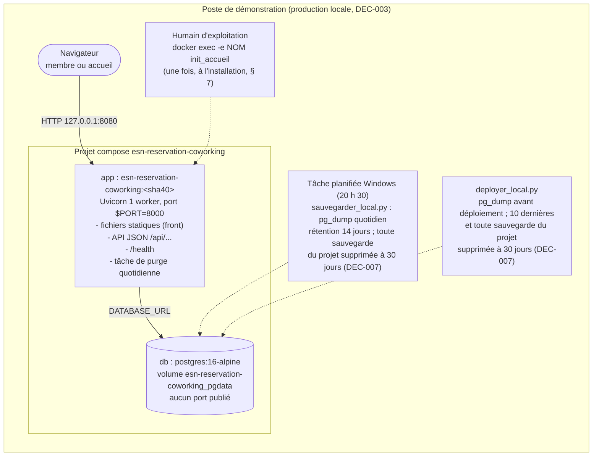

<!-- modèle : templates/architecture.md v0.2 · responsable du modèle : A -->

# Architecture technique — Réservation de salles, Coworking Les Arcades (Perpignan)

Source : [cdc.md](cdc.md) (v1.0, `VALIDÉ`, DEC-006). Hébergement : [DEC-003](../../docs/decisions/2026-11-24-DEC-003-production-locale-docker.md) (production locale Docker). Ticket de travail : [T-004](tickets/T-004-architecture.md). Validation : [T-005](tickets/T-005-choix-techniques.md). Arbitrages humains sur T-005 : [DEC-007](../../docs/decisions/2026-11-24-DEC-007-choix-techniques-coworking.md).

> Convention. « CDC F-xx », « CDC § n » et « H-nn » renvoient au CDC validé. Les arbitrages rendus par l'humain sur T-005 (points A à G) sont cités « (Ethan, 2026-11-24, DEC-007) ». Les points qui restent à confirmer sont listés au § 11.

> Historique des versions (le template n'a pas de section dédiée ; la note est placée ici).
> - **v0.1 (2026-11-24)** : première version, 17 décisions, sept points soumis à arbitrage dans T-005 (A à G).
> - **v0.2 (2026-11-24)** : intègre les arbitrages d'Ethan sur T-005 (Ethan, 2026-11-24, DEC-007). Changements : (A) stack A1 **retenue**, décisions 1 à 6 du § 9 marquées retenues ; (B) procédure exacte et pas à pas de `init_accueil` par `docker exec` avec variable passée sans valeur, en PowerShell 7.1+, Windows PowerShell 5.1 et bash/Git Bash, avec les contrôles de non-fuite (§ 7), décision 11 retenue ; (C) absence de clé de signature des sessions **prise en compte** comme écart de forme au CDC § 8, CDC non modifié (§ 6, § 7, décision 6) ; (D) sauvegarde quotidienne par une **commande ajoutée à l'outillage commun** qui réutilise `scripts/prod_locale.py`, **rétention de 14 jours**, tâche planifiée Windows documentée ; la proposition v0.1 d'une limite de 30 jours pour toutes les sauvegardes du projet est **retirée**, les sauvegardes d'avant déploiement restent à la règle DEC-003 (§ 8, décision 14) ; (E) accès limité au poste (`127.0.0.1`) **accepté comme limite de la démonstration** (§ 11) ; (F) pas de suppression de compte accueil (§ 7) ; (G) seuils **acceptés provisoirement**, à confirmer par l'audit `securite` et la revue humaine de Karim (§ 6, § 7) ; ajout du § 11 « Risques et limites » (dont l'allocation de Karim, à décider au planning).
> - **v0.3 (2026-11-24)** : intègre trois corrections d'Ethan (Ethan, 2026-11-24, DEC-007). (1) **Seuil global de 30 échecs : plus de blocage global**. Au-delà de 30 échecs de connexion toutes adresses confondues en 15 min, l'app journalise une alerte (format fixé au § 6, sans nom, e-mail ni mot de passe), remontée par `analyste-prod`, sans bloquer personne ; seul le blocage par compte reste (§ 6, § 7, décision 8, R-04). (2) **R-03 traité** : toute sauvegarde du projet (d'avant déploiement et quotidienne) est supprimée au plus tard 30 jours après sa création, en plus de la règle des 10 dernières (DEC-003) et de la rétention de 14 jours des quotidiennes ; comportement attendu de `scripts/sauvegarder_local.py` et de l'ajout à `scripts/prod_locale.py` (accord de C), tests décrits ; durée maximale réelle (30 jours) à indiquer dans la page de confidentialité (H-21) (§ 3, § 6, § 8, décision 14, § 10, R-03, R-05). (3) **Pourquoi de C** repris : avec des sessions stockées en base, l'identifiant de session est un jeton aléatoire vérifié côté serveur, l'exigence du CDC (protéger les sessions) est couverte sans clé de signature (§ 6, décision 6, R-06).
> - **v0.4 (2026-11-24)** : intègre deux décisions d'Ethan (Ethan, 2026-11-24, DEC-007). (1) **La limite de 30 jours s'applique aussi au déploiement** : `purger_sauvegardes()` de `scripts/prod_locale.py`, appelée par `deployer_local.py` après chaque sauvegarde d'avant déploiement réussie, supprime d'abord toute sauvegarde du projet de plus de 30 jours (dossiers `sauvegardes/` et `sauvegardes-quotidiennes/`), puis applique la règle des 10 dernières ; `sauvegarder_local.py` applique aussi la limite aux deux dossiers. Le code de `deployer_local.py` ne change pas (même appel), mais son comportement si. `test_retention` est adapté : ses fichiers d'essai sont datés par rapport au jour du test (`maintenant()`), et non plus au 2025-01-01. Ses assertions ne changent pas : c'est un changement des données d'essai. Pourquoi : la garantie RGPD ne doit pas dépendre d'une tâche planifiée qui peut ne pas tourner. L'ancienne alternative (d) de la décision 14 devient l'option retenue ; l'option v0.3 « commande quotidienne seule » devient une alternative écartée (§ 3, § 6, § 8, décision 14, § 10, R-03, R-05). (2) **Revue de Karim** : l'architecture est validée par Ethan sans relecture préalable de Karim ; la revue humaine de Karim est **reportée aux tickets d'authentification (S3-R2)**. Les seuils G et les choix d'authentification seront confirmés lors de cette revue et de l'audit `securite` (§ 6, § 7, § 9, R-02, R-04).

## 1. Synthèse
Application web **monolithique dans un seul conteneur** : une API JSON en **Python 3.14 / FastAPI**, qui sert aussi un **front HTML/CSS/JavaScript sans étape de build**, sur **PostgreSQL 16** (service `db` du modèle commun DEC-003). Les règles métier (créneaux, quota, avance, délai d'annulation, purge) sont isolées dans un module pur testé avec une horloge injectable ; l'unicité d'un créneau est garantie **par la base** (contrainte `UNIQUE`) et le quota par un verrou de ligne. L'authentification repose sur des **mots de passe hachés en Argon2id** et des **sessions opaques stockées en base** (aucune clé de signature à gérer) ; le rôle est contrôlé côté serveur à chaque requête. Cette stack (option A1 de T-005) est **retenue** : la plus simple à maintenir et à auditer pour ce périmètre, sans chaîne de build front ni clé secrète à gérer (Ethan, 2026-11-24, DEC-007).

## 2. Stack
Versions vérifiées le **2026-11-24** par recherche web (sources en note ci-dessous). Le `dev-backend` fige les versions exactes dans `app/requirements.txt` (épinglage `==`) au premier ticket ; la ligne de version (mineure) retenue ici fait foi, le correctif peut être le plus récent de cette ligne.

| Couche | Technologie | Version | Justification |
|---|---|---|---|
| Frontend | HTML5, CSS, JavaScript (modules ES natifs), **sans framework ni build** ; servi en fichiers statiques par l'app | — (standards du navigateur) | 6 à 8 écrans simples (connexion, disponibilités, mes réservations, vue du jour, comptes, mot de passe, mention RGPD). Aucune exigence ne motive un framework (règle 9, S4-R5) ; aucune dépendance npm à auditer ; formulaires natifs = accessibilité de base (CDC § 5). Décision 3. |
| Backend | **Python** | **3.14** (3.14.10 au 2026-10-25) | Ligne en maintenance corrective (3.13 n'a plus que des correctifs de sécurité). Compétence de l'équipe : `dev-backend` (`backend-python`), Karim expert. `securite.yml` (DEC-003) audite déjà le Python (`pip-audit`, `bandit`). Image de base `python:3.14-slim`. |
| Backend | **FastAPI** + serveur **Uvicorn** | FastAPI **0.162** (0.162.7 au 2026-11-13) ; Uvicorn **0.52** (0.52.0) | API JSON avec validation des entrées par Pydantic (fourni par FastAPI), injection de dépendances pour l'authentification, le rôle et l'horloge. Décision 2. |
| Backend | **SQLAlchemy** (ORM / Core) + **Alembic** (migrations) + pilote **psycopg 3** | SQLAlchemy **2.0** (2.0.51) ; Alembic **1.18** (1.18.4 au 2026-02-10) ; psycopg **3.3** (3.3.8) | Requêtes paramétrées (pas d'injection SQL), `SELECT … FOR UPDATE`, migrations versionnées compatibles avec un rollback (§ 8). Décision 4. |
| Backend | **argon2-cffi** (hachage Argon2id) ; **tzdata** (fuseau Europe/Paris pour `zoneinfo`) | argon2-cffi **25.1** (25.1.0) ; tzdata **2026.6** | Argon2id est l'algorithme adapté aux mots de passe recommandé par l'OWASP (CDC F-04, § 8). `tzdata` garantit le fuseau même si l'image slim n'a pas la base système. Décision 5. |
| Base de données | **PostgreSQL** (image `postgres:16-alpine` du modèle commun) | **16** (16.16 au 2026-11-12) | Imposé par DEC-003 ; contraintes `UNIQUE`/`CHECK`, verrous de ligne, `pg_dump`. Pas de SQLite, ni en production ni dans les tests d'intégration (comportement de concurrence différent). |
| Tests | **pytest**, **httpx** (client de test FastAPI), **Playwright** pour Python (bout en bout) | pytest **9.1** (9.1.1 au 2026-06-19) ; httpx **0.28** (0.28.1) ; Playwright **1.65** | Une seule langue pour tous les tests ; Playwright reste hors de l'image de production (dépendances de développement seulement). Décision 17. |
| Hébergement | Production locale Docker (par défaut, DEC-003) | Docker Compose, modèle `deploiement/docker-compose.yml` | Projet compose `esn-reservation-coworking`, image `esn-reservation-coworking:<sha40>`, publiée sur `127.0.0.1:8080` (`url_prod: http://localhost:8080`). Coût nul. Décision 16. |

**Notes de vérification des versions (2026-11-24).**
- Python : [3.14 sur python.org](https://www.python.org/downloads/release/python-31410/) (3.14.10, 2026-10-25) ; 3.13 en sécurité seule depuis 3.13.16 ([python.org](https://www.python.org/downloads/release/python-31318/)).
- FastAPI : [pepy.tech](https://pepy.tech/projects/fastapi) (0.162.7, 2026-11-13) ; non recoupé sur pypi.org.
- Uvicorn : [pypi.org, 0.52.0](https://pypi.org/project/uvicorn/0.52.0/) ; date non trouvée.
- SQLAlchemy : [page de téléchargement officielle](https://www.sqlalchemy.org/download.html) (2.0.51 « Current Release » ; 2.1 encore en bêta, écartée).
- Alembic : [changelog officiel](https://alembic.sqlalchemy.org/en/latest/changelog.html) (1.18.4, 2026-02-10). Un fichier 1.20.0 est apparu sur pypi.org sans changelog : **non retenu tant qu'il n'est pas confirmé**.
- psycopg : [pypi.org](https://pypi.org/project/psycopg/) (3.3.8) ; [annonce 3.3](https://www.psycopg.org/articles/2025/12/01/psycopg-33-released).
- argon2-cffi : [pepy.tech](https://pepy.tech/project/argon2-cffi) et [miroir PyPI](https://simple-repository.app.cern.ch/project/argon2-cffi) (25.1.0) ; dernière version ancienne (2025-06), bibliothèque stable, à surveiller par le `veilleur`.
- tzdata : [pypi.org](https://pypi.org/project/tzdata) (2026.6, attestation du 2026-10-28).
- PostgreSQL : [notes de version 16.16](https://www.postgresql.org/docs/16/release-16-16.html) (2026-11-12).
- pytest : [GitHub releases](https://github.com/pytest-dev/pytest/releases) (9.1.1, 2026-06-19) ; une 9.2.0 est signalée sans confirmation : non retenue.
- httpx : [miroir PyPI](https://simple-repository.app.cern.ch/project/httpx) (0.28.1, stable ; les 1.0 sont des préversions, écartées).
- Playwright : [notes de version Python](https://playwright.dev/python/docs/release-notes) (1.65).
- **Écart de confiance** : FastAPI, Uvicorn et Playwright n'ont pas pu être recoupés sur pypi.org. Le `dev-backend` confirme la version exacte par `pip index versions <paquet>` au premier ticket et le `veilleur` l'enregistre (CDC § 9, veille). Pydantic, Starlette et les autres dépendances transitives sont figées par l'épinglage, sans choix propre.

## 3. Schéma


**Découpage interne de l'app** (`projets/reservation-coworking/app/`, à titre de cadre pour le découpage en tickets du `chef-de-projet`) :

| Composant | Rôle | Exigences CDC |
|---|---|---|
| `regles` (module pur, sans base ni HTTP) | plages horaires lun-ven 8 h-20 h, avance J à J+14, créneau commencé, quota de 2 par jour, délai d'annulation (membre : avant le début ; accueil : avant la fin), date limite de purge | F-01, F-02, F-08, H-10 à H-13, H-15, H-17 |
| `horloge` | fournit « maintenant » en Europe/Paris ; remplacée dans les tests (CDC § 7) | toutes les règles de date |
| `auth` | hachage Argon2id, sessions opaques, limitation des tentatives, changement de mot de passe obligatoire, dépendances `utilisateur_connecte` et `exiger_role("accueil")` | F-04, F-07, CDC § 8 |
| `api.reservations` | disponibilités, réservation, mes réservations, annulation | F-01, F-02 |
| `api.accueil` | vue des réservations du jour, annulation par l'accueil | F-02, F-03 |
| `api.comptes` | création membre / accueil, suppression membre, réinitialisation | F-07 |
| `api.moi` | profil courant, changement de son mot de passe | F-04 |
| `init_accueil` (commande) | création du compte accueil initial à partir de variables d'environnement | F-07 (Q-14) |
| `purge` (commande + tâche) | suppression des réservations de plus de 12 mois | F-08 |
| `demarrer` (point d'entrée de l'image) | migrations tolérantes (§ 8), avertissement si aucun compte accueil, lancement d'Uvicorn | F-07, § 8 |
| `static/` | pages HTML, CSS adaptatif, scripts JS ; page « Confidentialité » (texte validé par le client, H-21) | F-01 à F-04, F-06, F-07, CDC § 5, § 8 |

**API (indicative, contrat détaillé par le `dev-backend`).** Toutes les routes `/api/*` exigent une session, sauf la connexion ; les routes `/api/accueil/*` exigent le rôle accueil.

| Méthode et route | Rôle | Effet |
|---|---|---|
| `POST /api/session` · `DELETE /api/session` | public · connecté | connexion · déconnexion |
| `GET /api/moi` · `PUT /api/moi/mot-de-passe` | connecté | profil (nom, rôle, `doit_changer_mdp`) · changement de son mot de passe (ancien exigé) |
| `GET /api/salles` | connecté | fiches des salles (F-06) |
| `GET /api/disponibilites?date=AAAA-MM-JJ` | connecté | 3 salles × 12 créneaux, « libre » ou « occupé », **sans nom de l'occupant** pour un membre |
| `POST /api/reservations` | membre | réserve `{salle_id, date, heure}` pour l'utilisateur connecté (jamais un id d'utilisateur fourni par le client) |
| `GET /api/reservations/miennes` | membre | ses réservations à venir |
| `DELETE /api/reservations/{id}` | membre (les siennes) ou accueil | annulation ; une réservation d'autrui renvoie **404** (pas 403, pour ne pas confirmer son existence) |
| `GET /api/accueil/reservations-du-jour` | accueil | date du jour, triée par heure : salle, créneau, nom, e-mail |
| `GET`, `POST /api/accueil/comptes` | accueil | liste, création (membre ou accueil) |
| `DELETE /api/accueil/comptes/{id}` | accueil | suppression d'un compte **membre** |
| `POST /api/accueil/comptes/{id}/reinitialisation` | accueil | mot de passe temporaire, changement forcé |
| `GET /health` | public | § 5 |

La documentation interactive de FastAPI (`/docs`, `/redoc`, `/openapi.json`) est **désactivée en production** (surface d'attaque) ; le schéma OpenAPI est généré dans les tests et versionné pour le `dev-frontend`.

## 4. Données et persistance

**Modèle de données** (PostgreSQL 16, schéma créé et modifié uniquement par migrations Alembic).

| Table | Colonnes principales | Contraintes |
|---|---|---|
| `utilisateur` | `id` (bigint, identité), `nom` (texte ≤ 100), `email` (texte ≤ 254, normalisé en minuscules), `mot_de_passe_hash` (texte, format PHC Argon2id), `role` (`membre` \| `accueil`), `doit_changer_mdp` (booléen, vrai à la création et à la réinitialisation), `cree_le`, `mdp_change_le` (horodatages) | `UNIQUE (email)` ; `CHECK role IN (...)` |
| `salle` | `id` (smallint), `nom`, `capacite` (entier, facultatif), `equipements` (texte, facultatif), `ordre` | 3 lignes « Salle 1/2/3 » insérées par migration (H-20) |
| `reservation` | `id` (bigint), `salle_id` → `salle`, `utilisateur_id` → `utilisateur` **`ON DELETE CASCADE`**, `date_creneau` (date), `heure_debut` (smallint), `cree_le` | **`UNIQUE (salle_id, date_creneau, heure_debut)`** ; `CHECK heure_debut BETWEEN 8 AND 19` ; `CHECK EXTRACT(ISODOW FROM date_creneau) <= 5` ; index `(utilisateur_id, date_creneau)` et `(date_creneau)` |
| `session` | `jeton_hash` (bytea, SHA-256 du jeton, clé primaire), `utilisateur_id` → `utilisateur` **`ON DELETE CASCADE`**, `cree_le`, `derniere_activite`, `expire_le` | index `(utilisateur_id)` |

- **Annulation = suppression de la ligne** (décision 10) : le créneau redevient libre immédiatement, la vue de l'accueil ne la montre plus, et aucune donnée inutile n'est conservée (minimisation). Une seconde annulation renvoie 404 « réservation introuvable ou déjà annulée », sans erreur serveur (F-02).
- **Unicité sous concurrence** (F-01, parcours 2) : deux `INSERT` simultanés sur le même créneau, la base n'en accepte qu'un ; l'autre lève une violation d'unicité, traduite en **409** « créneau indisponible ». Aucune vérification préalable en Python ne sert de garantie.
- **Quota de 2 par jour sous concurrence** (F-01, H-12) : la transaction de réservation commence par `SELECT … FROM utilisateur WHERE id = :moi FOR UPDATE`, puis compte les réservations du membre pour la date, puis insère. Deux réservations simultanées du même membre sont ainsi sérialisées ; celles de membres différents ne se bloquent pas.
- **Règles de date** : toutes calculées en Europe/Paris à partir de l'`horloge` injectée. Un créneau est « commencé » si `maintenant >= date_creneau + heure_debut`. Les `CHECK` de la base sont un filet : la règle et son message clair sont dans `regles`. Jours fériés non gérés (H-17).
- **Suppression d'un compte membre** (F-07, H-14) : un seul `DELETE FROM utilisateur` ; les réservations (passées et à venir) et les sessions partent en cascade ; les créneaux à venir sont libérés. Le test d'intégration contrôle en base qu'il ne reste ni nom, ni e-mail, ni empreinte, ni réservation liée.
- **Purge à 12 mois** (F-08, H-13) : `DELETE FROM reservation WHERE date_creneau < :limite`, où `:limite` = même jour, 12 mois plus tôt (29 février → 28 février), calculée par `regles` avec l'horloge. Une réservation de 12 mois et 1 jour est supprimée, une de 11 mois et 29 jours conservée. Lancée au démarrage de l'app, puis toutes les 24 h par une tâche de fond, et sur demande par `python -m reservation.purge` (recette). Trace : une ligne de journal avec **le nombre de lignes supprimées seulement**.
- **Sessions expirées** : supprimées par la même tâche quotidienne.
- **Données personnelles** : nom et e-mail (et l'empreinte du mot de passe). Aucune autre donnée collectée (F-04). Les membres ne voient jamais le nom ni l'e-mail d'un autre membre (la grille montre « occupé ») ; seule la vue de l'accueil les affiche, pour la date du jour (CDC § 8).
- **Fiches des salles** (F-06) : table `salle`. Changer un nom, une capacité ou des équipements se fait par une migration de données ou une requête SQL d'exploitation, sans toucher au code des réservations. Aucun écran d'administration n'est prévu (non demandé).
- **Persistance en production** : volume nommé `esn-reservation-coworking_pgdata` du modèle commun ; la base n'est joignable que depuis le réseau du projet compose. Volume attendu : quelques milliers de lignes par an (3 salles × 12 créneaux × ~250 jours ouvrés = 9 000 créneaux au maximum).

## 5. Endpoint `/health` (obligatoire)
Renvoie au minimum `{ "status": "ok", "commit": "<SHA déployé>" }`, à partir de `GIT_COMMIT`, figé dans l'image par `ARG GIT_COMMIT` (repli : `RENDER_GIT_COMMIT`, sinon `"inconnu"`).

- **Valeur de `commit`** : `os.environ.get("GIT_COMMIT") or os.environ.get("RENDER_GIT_COMMIT") or "inconnu"`. Le `Dockerfile` déclare `ARG GIT_COMMIT` puis `ENV GIT_COMMIT=$GIT_COMMIT` ; `deployer_local.py` passe `--build-arg GIT_COMMIT=<sha40>`. Le SHA n'est jamais passé au lancement : après un rollback, `/health` annonce le SHA de l'image relancée.
- **Contrôle de la base** : `/health` exécute `SELECT 1` (délai 1 s). Base joignable : **200** `{"status": "ok", "commit": "…"}`. Base injoignable : **503** `{"status": "ko", "commit": "…"}`. `verifier-prod` ne conclut donc « EN LIGNE ET À JOUR » que si l'app répond **et** atteint sa base ; un déploiement dont la base est inaccessible part en ÉCHEC puis en rollback (S3-R6).
- **Accès** : public, sans session, exempté du changement de mot de passe obligatoire ; ne renvoie aucune autre information (ni version de bibliothèque, ni donnée).

## 6. Couverture des exigences non fonctionnelles du CDC
Une ligne par exigence non fonctionnelle du CDC (§ 5, § 7, § 8, § 9).

| Exigence CDC | Réponse architecturale |
|---|---|
| § 5 Performance : disponibilités d'une journée en moins de 2 s (H-05) | Une seule requête indexée sur `reservation(date_creneau)` pour 36 créneaux ; front statique sans build ; Uvicorn 1 worker suffit pour quelques dizaines de membres. Le `testeur` mesure le temps de `GET /api/disponibilites` en test d'intégration (seuil 2 s, attendu < 200 ms). |
| § 5 Disponibilité : heures d'ouverture, pas de 24 h/24 (H-06) | `restart: unless-stopped` sur `app` et `db` (modèle commun) ; `/health` contrôle la base ; repli manuel par l'accueil (runbook `coupure-serveur`). **Limite de la production locale** : l'app n'est joignable que depuis le poste de démonstration (`127.0.0.1`), limite acceptée pour la démonstration (Ethan, 2026-11-24, DEC-007), voir § 7 et § 11. |
| § 5 Accessibilité : bonnes pratiques de base, interface en français (H-07) | HTML sémantique, formulaires natifs avec `<label>`, focus visible, navigation au clavier, messages d'erreur liés aux champs (`aria-describedby`), contraste AA visé, `lang="fr"`. Contrôle par Léa (revue accessibilité, AF3 frontend) si le `chef-de-projet` l'affecte. |
| § 5 Compatibilité : navigateurs récents, ordinateur et téléphone (H-07) | Modules ES et `fetch` (supportés par tous les navigateurs récents) ; CSS adaptatif sans framework (grille qui passe en liste sous 600 px). Test de bout en bout Playwright en viewport ordinateur et mobile. En démonstration, le mobile est vérifié par émulation (la production locale n'est pas joignable d'un téléphone). |
| § 7 Parcours critiques 1 à 13 | Chaque parcours a un composant responsable (tableau du § 3) ; les parcours d'autorisation (6, 8, 9, 12, 13) se testent par **appel direct à l'API** JSON. |
| § 7 Niveau de tests : unitaires (règles, rôles), intégration (API + base), bout en bout (parcours 1, 5, 7), recette humaine | Unitaires sur `regles` (sans base) ; intégration avec le client de test httpx sur un **PostgreSQL 16 réel** (conteneur jetable), y compris le test de concurrence à deux connexions et les contrôles en base (hachage, suppression de compte) ; bout en bout Playwright sur l'image construite. Seuil de couverture proposé au `testeur` : **80 % des lignes** sur `regles` et `auth`, sans seuil global. Les tests des apps clientes dans `ci.yml` sont reportés au lot 6 (DEC-003) : d'ici là, le `testeur` les lance localement. |
| § 7 Horloge injectable, fuseau Europe/Paris (H-17) | Composant `horloge` injecté par dépendance FastAPI et remplacé dans les tests (`app.dependency_overrides`) ; `zoneinfo("Europe/Paris")` avec le paquet `tzdata`. Aucune règle n'appelle `datetime.now()` directement (contrôle du `relecteur-code`). |
| § 7 Jeu de données de recette : 3 salles, membres fictifs, accueil fictif, aucune donnée réelle | Commande de développement `python -m reservation.donnees_demo` (absente du chemin de démarrage de production), qui n'insère que des données fictives ; le compte accueil de recette passe par `init_accueil`. |
| § 7 Cas de bord (minuit, changement de semaine, J+14/J+15, 7 h/19 h/20 h, double annulation, e-mail en double) | Tous dans `regles` (tests unitaires paramétrés) ; e-mail en double par `UNIQUE (email)` → 409 ; double annulation → 404 (§ 4). |
| § 8 Minimisation : nom, e-mail, empreinte du mot de passe, rôle ; rien d'autre | Modèle du § 4 : aucune autre colonne personnelle ; validation Pydantic qui refuse les champs inconnus (`extra="forbid"`). |
| § 8 Finalité, base légale, responsable de traitement (H-03) | Hors technique : arbitrage humain (`juridique`, `rgpd`). L'architecture limite les traitements à la finalité (pas d'export, pas de statistiques). |
| § 8 Conservation 12 mois puis suppression (F-08) | Purge du § 4 (démarrage, quotidienne, sur demande), trace sans donnée personnelle. |
| § 8 Suppression d'un compte sur demande (F-07, H-14) | `DELETE` en cascade (§ 4) ; persistance dans les sauvegardes : **30 jours au plus dans toute sauvegarde du projet** (14 jours dans les quotidiennes), par la limite d'âge appliquée à chaque déploiement (`purger_sauvegardes()`, appelée par `deployer_local.py`) et à chaque exécution de `sauvegarder_local.py` (§ 8 de ce document ; R-03 traité, Ethan, 2026-11-24, DEC-007). |
| § 8 Information des membres (mention de confidentialité, H-21) | Page statique `confidentialite.html`, liée depuis la connexion et le pied de page ; texte proposé par l'ESN, validé par Marie Lenoir avant la mise en ligne. Elle indique la **durée maximale réelle de persistance dans les sauvegardes : 30 jours** après la création de la sauvegarde (§ 8). |
| § 8 Vue de l'accueil limitée au nom, à l'e-mail et au créneau du jour | `GET /api/accueil/reservations-du-jour` ne prend pas de paramètre de date et ne renvoie que ces champs. |
| § 8 Journaux sans nom, e-mail ni mot de passe | Journalisation par identifiant technique (`utilisateur_id`) seulement ; aucune donnée personnelle dans les URL (e-mail et mots de passe dans le corps des requêtes, jamais en paramètre) ; corps des requêtes jamais journalisés ; trace de purge = compteur ; alerte d'échecs de connexion = compteurs seulement (ligne « Limitation des tentatives » ci-dessous). Test : recherche de l'e-mail et du mot de passe de test dans les journaux capturés. |
| § 8 Authentification par e-mail et mot de passe, deux rôles | Composant `auth` ; rôle lu en base à chaque requête via la session (jamais stocké côté client). |
| § 8 Rôles contrôlés côté serveur à chaque requête | Dépendances `utilisateur_connecte` et `exiger_role("accueil")` déclarées au niveau des routeurs ; test d'autorisation automatique qui parcourt **toutes** les routes de l'API avec un visiteur, un membre, un membre qui doit changer son mot de passe et un accueil (matrice attendue versionnée). |
| § 8 Hachage et salage adaptés, jamais en clair (base, journaux, réponses) | Argon2id (argon2-cffi, paramètres par défaut RFC 9106 : 3 passes, 64 Mio, 4 fils, sel aléatoire de 16 octets) ; ré-hachage à la connexion si les paramètres changent ; aucun modèle de réponse ne contient de champ mot de passe ou empreinte. |
| § 8 Messages d'échec identiques (pas d'énumération) | Message unique « E-mail ou mot de passe incorrect » ; pour un e-mail inconnu, une vérification Argon2 factice est exécutée pour égaliser le temps de réponse. |
| § 8 Limitation des tentatives (F-04, seuil à fixer) | **Seul blocage : par compte**, **5 échecs par e-mail en 15 min → refus pendant 15 min** pour cet e-mail, message identique que le compte existe ou non ; accepté provisoirement (Ethan, 2026-11-24, DEC-007), à confirmer lors de l'audit `securite` et de la revue humaine des tickets d'authentification par Karim (S3-R2). **Aucun blocage global** (Ethan, 2026-11-24, DEC-007) : un blocage global permettrait à un attaquant d'empêcher tous les membres de se connecter (déni de service) ; le blocage par compte suffit. **Alerte globale** : au-delà de **30 échecs toutes adresses confondues en 15 min** (fenêtre glissante, donc à partir du 31e), l'app **journalise une alerte sans bloquer personne**. Format, une ligne sur la sortie standard du conteneur (`docker logs`, et extraits `rapports/logs-*`), préfixe fixe pour la recherche : `ALERTE_SECURITE evenement=echecs_connexion_global echecs=<n> seuil=30 fenetre_min=15 comptes_bloques=<n> depuis=<AAAA-MM-JJTHH:MM:SS±HH:MM>`. Elle ne contient **que des compteurs et une date** : ni nom, ni e-mail, ni mot de passe, ni identifiant d'utilisateur, ni adresse IP (CDC § 8). Émise au franchissement du seuil, puis au plus une fois par période de 15 min tant que le seuil reste dépassé (pas d'inondation des journaux). **Repérage par `analyste-prod`** : recherche de `ALERTE_SECURITE` ; toute occurrence donne un ticket `incident` de priorité `haute` proposée (tentative de force brute ou de bourrage d'identifiants), avec signal au coordinateur (runbook `intrusion` à envisager). Compteurs **en mémoire** (aucune donnée stockée ; remis à zéro au redémarrage). Tests : 30 échecs n'émettent rien, le 31e émet une ligne ; après l'alerte, un autre compte se connecte normalement ; la ligne capturée ne contient ni l'e-mail ni le mot de passe de test. |
| § 8 Expiration de session | **2 h d'inactivité, 12 h au maximum**, accepté provisoirement (Ethan, 2026-11-24, DEC-007), à confirmer lors de l'audit `securite` et de la revue humaine des tickets d'authentification par Karim (S3-R2) ; jeton renouvelé à la connexion et au changement de mot de passe ; toutes les sessions d'un utilisateur révoquées à son changement ou à sa réinitialisation de mot de passe, et à la suppression du compte. |
| § 8 Cookies ou jetons protégés | Jeton aléatoire de 256 bits (`secrets.token_urlsafe(32)`), stocké en base sous forme de SHA-256 seulement ; cookie `HttpOnly`, `SameSite=Strict`, `Path=/`, et `Secure` dès que la requête arrive en HTTPS (en local, le trafic ne quitte pas le poste). |
| § 8 Robustesse du mot de passe (à fixer) | **12 à 128 caractères**, différent de l'e-mail et de l'ancien mot de passe, pas de règle de composition imposée (recommandations OWASP et ANSSI pour un mot de passe long), accepté provisoirement (Ethan, 2026-11-24, DEC-007), à confirmer lors de l'audit `securite` et de la revue humaine des tickets d'authentification par Karim (S3-R2). Le front propose un mot de passe généré à la création et à la réinitialisation. |
| § 8 Injection, XSS, CSRF, validation des entrées | Injection : requêtes paramétrées SQLAlchemy uniquement (aucune concaténation SQL, contrôle `bandit` et `relecteur-code`). XSS : le front n'insère les données qu'avec `textContent` (jamais `innerHTML`), en-tête **CSP** `default-src 'self'; script-src 'self'; style-src 'self'; frame-ancestors 'none'; base-uri 'none'; form-action 'self'`, `X-Content-Type-Options: nosniff`, `Referrer-Policy: no-referrer`. CSRF : cookie `SameSite=Strict`, **corps JSON obligatoire** sur toute requête qui modifie (`Content-Type: application/json`, impossible à envoyer d'un autre site sans pré-vol CORS, et CORS n'est pas ouvert), **contrôle de l'en-tête `Origin`**. Entrées : schémas Pydantic stricts (types, longueurs, dates, `extra="forbid"`). |
| § 8 Protection contre l'énumération des réservations d'autrui | Accès à une réservation filtré par propriétaire dans la requête SQL ; réponse 404 identique pour « inexistante » et « d'un autre membre » ; aucune route ne liste les réservations d'autrui hors rôle accueil. |
| § 8 Compte accueil initial par script, mot de passe par variable d'environnement, jamais dans le dépôt | Commande `python -m reservation.init_accueil`, lancée **une fois par un humain** dans le conteneur en cours d'exécution par `docker exec`, avec `ACCUEIL_EMAIL` et `ACCUEIL_MOT_DE_PASSE_INITIAL` **passées sans valeur** (`-e NOM`) depuis la session de son terminal, où elles ont été saisies sans affichage juste avant puis effacées juste après (procédure pas à pas au § 7, retenue : Ethan, 2026-11-24, DEC-007). Idempotente : si un compte accueil existe déjà, elle ne crée rien et n'écrase rien (code 0, message explicite) ; variable absente : rien n'est créé, message et code non nul. Elle n'affiche ni l'e-mail ni le mot de passe. Au démarrage, l'app journalise un avertissement tant qu'aucun compte accueil n'existe. |
| § 8 Changement obligatoire du mot de passe à la première connexion, pour tous les comptes | Colonne `doit_changer_mdp`, vraie à toute création (script, accueil) et à toute réinitialisation ; tant qu'elle est vraie, une dépendance globale refuse **toute** route sauf `GET /api/moi`, `PUT /api/moi/mot-de-passe`, `DELETE /api/session` et `/health` (403 `changement_mot_de_passe_requis`) ; le front redirige vers l'écran de changement. Après changement : nouvelle empreinte, ancienne inutilisable, autres sessions révoquées. |
| § 8 Réinitialisation par l'accueil seulement, sans libre-service | Route `/api/accueil/comptes/{id}/reinitialisation` (rôle accueil) ; aucune route de réinitialisation publique ; mot de passe temporaire haché, `doit_changer_mdp` vrai, sessions de la cible révoquées. |
| § 8 Audit `securite` et revue humaine des tickets d'authentification par Karim (AF3), et du ticket de purge | L'architecture isole l'authentification dans `auth` et `api.comptes`, et la purge dans `purge` : les tickets correspondants sont identifiables pour la revue humaine (le `chef-de-projet` crée les tickets compagnons « Revue humaine T-NNN »). L'architecture est validée par Ethan sans relecture préalable de Karim : sa revue humaine porte sur les tickets d'authentification (S3-R2), où il confirme aussi les seuils G et les choix d'authentification (Ethan, 2026-11-24, DEC-007). |
| § 8 Secrets hors dépôt (base, clé de session, mot de passe accueil initial) | Base : `PG_PASSWORD` tiré au hasard par `deployer_local.py`, gardé dans `deploiement/local/reservation-coworking/db_password` (ignoré par Git), transmis par `DATABASE_URL`. **Clé de session : aucune** (décision 6) : avec des sessions stockées en base, l'identifiant de session est un jeton aléatoire vérifié côté serveur ; l'exigence du CDC (protéger les sessions) est couverte sans clé de signature (Ethan, 2026-11-24, DEC-007). **Écart de forme au CDC § 8**, qui cite une « clé de signature des sessions » : pris en compte et tracé dans DEC-007 ; le CDC validé n'est pas modifié. Mot de passe accueil initial : saisi sans affichage dans la session du terminal de l'humain, jamais écrit sur disque, effacé après usage (§ 7). `app/env.example` (DEC-002, sans point initial) liste les variables sans aucune valeur. `gitleaks` (DEC-003) contrôle le dépôt. |
| § 8 Crise : perte de données | Restauration humaine depuis `pg_dump` (runbook `perte-donnees`), puis rejeu automatique de la purge au démarrage et rejeu manuel des suppressions de comptes (§ 8 de ce document). |
| § 8 Crise : coupure du service | `restart: unless-stopped`, `/health`, runbook `coupure-serveur` (constat `docker compose ps` et `logs`), repli manuel par l'accueil. |
| § 8 Crise : fuite de noms, e-mails ou empreintes | Empreintes Argon2id (coûteuses à attaquer) ; réinitialisation de tous les mots de passe possible par une commande d'exploitation (`python -m reservation.forcer_changement --tous` : `doit_changer_mdp` vrai et sessions révoquées pour tous) ; notification du client et de la CNIL sous 72 h (humain, runbook). |
| § 8 Crise : accès illégitime à un compte accueil | Révocation des sessions du compte et réinitialisation par un autre compte accueil ; à défaut, `init_accueil` ne s'applique pas (un compte existe), donc procédure humaine par la commande `forcer_changement` ciblée. |
| § 8 Crise : suppression demandée alors que des sauvegardes contiennent les données | Toute sauvegarde du projet supprimée **au plus tard 30 jours** après sa création, à chaque déploiement comme à chaque sauvegarde quotidienne (Ethan, 2026-11-24, DEC-007), en plus des 10 dernières pour les sauvegardes d'avant déploiement (DEC-003) et des 14 jours des quotidiennes ; durée maximale de 30 jours indiquée dans la page de confidentialité (§ 8 de ce document ; R-03 traité) ; après une restauration, rejeu des suppressions. |
| § 9 Disponibilité et fenêtre de support (H-06) | Pas d'astreinte ; même réponse que § 5 « Disponibilité ». |
| § 9 Canal de support (e-mail de l'ESN → tickets `support`) | Hors application ; l'adresse figure dans le pied de page et la page de confidentialité. |
| § 9 Veille sur la stack, dont la bibliothèque de hachage | Liste à surveiller par le `veilleur` : Python 3.14, FastAPI, Uvicorn, Starlette, Pydantic, SQLAlchemy, Alembic, psycopg, argon2-cffi, tzdata, images `python:3.14-slim` et `postgres:16-alpine`. `pip-audit` sur `app/requirements.txt` (workflow `securite.yml`, à brancher sur ce fichier). |
| § 9 Sauvegarde quotidienne, rétention courte et cohérente avec 12 mois | `pg_dump` avant chaque déploiement (DEC-003, 10 dernières) **plus** un `pg_dump` quotidien par une commande ajoutée à l'outillage commun (`scripts/sauvegarder_local.py`, nom proposé, qui réutilise `scripts/prod_locale.py`), lancée chaque jour par une tâche planifiée Windows sur le poste, **rétention de 14 jours**. **Toute sauvegarde du projet de plus de 30 jours** (avant déploiement et quotidienne) est supprimée **à chaque déploiement** (`purger_sauvegardes()` de `prod_locale.py`, appelée par `deployer_local.py`) **et à chaque exécution** de la commande quotidienne : la garantie ne dépend pas de la seule tâche planifiée (§ 8 ; Ethan, 2026-11-24, DEC-007, avec l'accord de C). Rétention courte et cohérente avec la conservation de 12 mois. |
| § 9 Rollback par image étiquetée par SHA | `rollback_local.py` (DEC-003) ; migrations compatibles avec l'image précédente (§ 8). |
| § 9 Après restauration : rejouer purge et suppressions | Purge rejouée automatiquement au démarrage ; suppressions de comptes rejouées par l'accueil à partir du registre des demandes tenu par le client (responsable du traitement), procédure dans le runbook `perte-donnees` (§ 8). |
| § 9 Maintenance après livraison hors budget | Stack sans build front ni dépendance npm, une seule langue, une seule image : coût de maintenance minimal pour le futur devis. |

## 7. Sécurité

**Authentification.**
- E-mail normalisé (minuscules, espaces retirés) ; mot de passe vérifié par Argon2id ; message d'échec unique ; temps de réponse égalisé pour les e-mails inconnus.
- Session opaque : jeton aléatoire de 256 bits dans un cookie `HttpOnly`, `SameSite=Strict` ; seule l'empreinte SHA-256 du jeton est en base, si bien qu'une fuite de la table `session` ne permet pas de se connecter. Expiration : 2 h d'inactivité, 12 h au maximum (accepté provisoirement, à confirmer lors de l'audit `securite` et de la revue humaine des tickets d'authentification par Karim, S3-R2 : Ethan, 2026-11-24, DEC-007).
- Changement de mot de passe obligatoire (création, réinitialisation, compte initial) appliqué par une dépendance globale, donc aussi aux appels directs à l'API.
- Limitation des tentatives en mémoire (seuils et format de l'alerte au § 6) : **blocage par compte seulement** (5 échecs par e-mail en 15 min → refus 15 min) ; au-delà de 30 échecs toutes adresses confondues en 15 min, **alerte journalisée `ALERTE_SECURITE`, sans blocage global**, remontée par `analyste-prod` (Ethan, 2026-11-24, DEC-007). Pourquoi : un blocage global permettrait à un attaquant d'empêcher tous les membres de se connecter (déni de service) ; le blocage par compte suffit. Elle suppose **un seul processus** Uvicorn : passer à plusieurs workers imposerait de déplacer les compteurs en base (noté pour la maintenance).

**Autorisations.**
- Deux rôles, lus en base à chaque requête. L'identité du membre qui réserve vient toujours de la session, jamais du corps de la requête.
- Matrice d'autorisation versionnée (route × profil → code attendu), testée automatiquement sur toutes les routes : une route ajoutée sans règle fait échouer le test.
- L'accueil ne peut supprimer que des comptes **membres** ; **pas de suppression de compte accueil**, hors CDC (Ethan, 2026-11-24, DEC-007). La route `DELETE /api/accueil/comptes/{id}` refuse une cible de rôle accueil ; le cas est dans la matrice d'autorisation. Un compte accueil d'un salarié parti est neutralisé par réinitialisation de son mot de passe par un autre compte accueil (sessions révoquées).

**Secrets.**
- Aucun secret dans le dépôt (S3-R8). `app/env.example` liste `PORT`, `DATABASE_URL`, `ACCUEIL_EMAIL`, `ACCUEIL_MOT_DE_PASSE_INITIAL` **sans valeur**, et rappelle que `GIT_COMMIT` est un argument de build.
- Mot de passe de la base : généré hors Git par `deployer_local.py` (modèle commun).
- Mot de passe accueil initial : **passé par l'humain d'exploitation, une seule fois, dans le conteneur en cours d'exécution**, selon la procédure ci-dessous (retenue : Ethan, 2026-11-24, DEC-007 ; décision 11).

**Procédure d'initialisation du compte accueil (une fois, après le premier déploiement vérifié).**
Objectif (DEC-007) : le mot de passe initial n'apparaît **ni dans l'historique du terminal, ni dans un fichier, ni chez un agent**. Principe : la valeur est saisie **sans affichage** dans la session du terminal, juste avant ; `docker exec -e NOM` (**sans `=valeur`**) la reprend de cette session ; elle est **effacée** juste après. Les noms de variables sont `ACCUEIL_EMAIL` et `ACCUEIL_MOT_DE_PASSE_INITIAL`.

1. **Préalables.**
   - Le déploiement a été vérifié (`/health` renvoie 200 avec le SHA attendu).
   - L'humain ouvre **un terminal ordinaire dédié**, hors de toute session Claude Code : ni agent, ni mode `!` d'une session, ni outil Bash d'un agent (le `deployeur` ne peut de toute façon pas lancer `docker exec`, garde-fou 7). Il fermera ce terminal à la fin.
   - Il choisit un mot de passe initial de 12 à 128 caractères (seuil G), généré par un gestionnaire de mots de passe, et ne l'écrit dans aucun fichier, ticket, message ni conversation. Ce mot de passe est temporaire : il devient inutilisable à la première connexion (changement obligatoire).
   - Il vérifie que le conteneur tourne : `docker ps --filter "name=esn-reservation-coworking-app-1" --format "{{.Names}} {{.Status}}"` doit afficher une ligne `Up`.
2. **Saisie, exécution, effacement**, selon le terminal. Les deux variables sont saisies avec une invite, pour qu'aucune valeur ne soit tapée dans une ligne de commande. L'effacement se fait **dans tous les cas**, même si `init_accueil` échoue.
   - **PowerShell 7.1 ou plus** (vérifier par `$PSVersionTable.PSVersion` ; `-MaskInput` n'existe qu'à partir de 7.1) :
     ```powershell
     $env:ACCUEIL_EMAIL = Read-Host "E-mail du compte accueil"
     $env:ACCUEIL_MOT_DE_PASSE_INITIAL = Read-Host "Mot de passe initial" -MaskInput
     docker exec -e ACCUEIL_EMAIL -e ACCUEIL_MOT_DE_PASSE_INITIAL esn-reservation-coworking-app-1 python -m reservation.init_accueil
     $code = $LASTEXITCODE
     Remove-Item Env:ACCUEIL_MOT_DE_PASSE_INITIAL, Env:ACCUEIL_EMAIL
     "code de sortie : $code"
     ```
   - **Windows PowerShell 5.1** (`-MaskInput` absent) : saisie en `SecureString`, convertie en texte **uniquement** dans la variable d'environnement de la session (jamais dans une variable PowerShell), puis `SecureString` détruite :
     ```powershell
     $env:ACCUEIL_EMAIL = Read-Host "E-mail du compte accueil"
     $s = Read-Host "Mot de passe initial" -AsSecureString
     $env:ACCUEIL_MOT_DE_PASSE_INITIAL = [System.Net.NetworkCredential]::new('', $s).Password
     $s.Dispose(); Remove-Variable s
     docker exec -e ACCUEIL_EMAIL -e ACCUEIL_MOT_DE_PASSE_INITIAL esn-reservation-coworking-app-1 python -m reservation.init_accueil
     $code = $LASTEXITCODE
     Remove-Item Env:ACCUEIL_MOT_DE_PASSE_INITIAL, Env:ACCUEIL_EMAIL
     "code de sortie : $code"
     ```
   - **bash ou Git Bash** (`read -s` n'affiche pas la saisie ; `export` est nécessaire pour que `docker` hérite de la variable) :
     ```bash
     read -r -p "E-mail du compte accueil : " ACCUEIL_EMAIL
     read -rs -p "Mot de passe initial : " ACCUEIL_MOT_DE_PASSE_INITIAL; echo
     export ACCUEIL_EMAIL ACCUEIL_MOT_DE_PASSE_INITIAL
     docker exec -e ACCUEIL_EMAIL -e ACCUEIL_MOT_DE_PASSE_INITIAL esn-reservation-coworking-app-1 python -m reservation.init_accueil
     code=$?
     unset ACCUEIL_MOT_DE_PASSE_INITIAL ACCUEIL_EMAIL
     echo "code de sortie : $code"
     ```
   - Résultat attendu : code 0 et un message « compte accueil créé » (ou « un compte accueil existe déjà, rien n'est modifié »), **sans l'e-mail ni le mot de passe**. Code non nul : lire le message (variable absente, base injoignable), corriger, puis reprendre l'étape 2 en entier.
3. **Contrôles de non-fuite** (à faire dans le même terminal, avant de le fermer). On ne cherche **jamais** le mot de passe en le tapant dans une commande, car cette commande irait elle-même dans l'historique : on cherche les **noms** de variables, ou on relit les dernières lignes.
   - **Variable effacée** : PowerShell, `Test-Path Env:ACCUEIL_MOT_DE_PASSE_INITIAL` renvoie `False` ; bash, `env | grep -c '^ACCUEIL_'` affiche `0`.
   - **Historique** : PowerShell, `Get-History` et `Get-Content (Get-PSReadLineOption).HistorySavePath -Tail 15` ; bash, `history | tail -n 15`. On ne doit y voir que les lignes `Read-Host` / `read` et `docker exec`, **aucune valeur** saisie.
   - **Configuration du conteneur** : `docker inspect esn-reservation-coworking-app-1 | Select-String ACCUEIL` (PowerShell) ou `| grep ACCUEIL` (bash) ne renvoie **rien** : une variable passée à `docker exec` ne modifie pas la configuration du conteneur. De même, `docker exec esn-reservation-coworking-app-1 env | Select-String ACCUEIL` (ou `| grep ACCUEIL`) ne renvoie rien : la variable n'existait que pour le processus `init_accueil`, terminé.
   - **Journaux de l'app** : `docker logs esn-reservation-coworking-app-1` ne contient ni l'e-mail ni le mot de passe (garanti par un test automatique du ticket `init_accueil`, qui capture la sortie avec des valeurs de test ; l'humain relit les dernières lignes).
4. **Contrôle fonctionnel et clôture.** L'humain se connecte avec l'e-mail et le mot de passe initial : l'écran de changement obligatoire s'affiche ; après le changement, le mot de passe initial est refusé. Il ferme le terminal. Si le mot de passe initial a pu être exposé avant ce changement (saisie visible, copie dans un fichier), il fait le changement immédiatement : l'ancien devient inutilisable.
5. **Trace** : le rapport de déploiement et le README de l'app indiquent que l'initialisation a été faite, par qui et quand, **sans aucune valeur**.

Limite connue : pendant les quelques secondes d'exécution, la valeur est présente dans l'environnement du processus `docker` de l'hôte et du processus `init_accueil` du conteneur ; elle n'est lisible que par l'utilisateur du poste et par root dans le conteneur. Acceptable pour un poste de démonstration mono-utilisateur. Alternative écartée : ajouter la variable au modèle commun `deploiement/docker-compose.yml` (décision 11).

**Surface d'attaque.**
- Port publié sur `127.0.0.1` seulement (modèle commun) ; base sans port publié.
- Pas de `/docs` ni `/openapi.json` en production ; pas de CORS ; pas d'envoi d'e-mail (F-05 exclue) ; aucun service tiers.
- Image : `python:3.14-slim`, utilisateur non root, aucune dépendance de développement (pytest, Playwright) dans l'image.
- En-têtes de sécurité et CSP au § 6.
- **Limite acceptée pour la démonstration** (Ethan, 2026-11-24, DEC-007) : en production locale, l'app n'est pas exposée sur un réseau ; une exposition réelle (téléphones des membres) exigerait HTTPS (cookie `Secure` alors actif automatiquement), un reverse proxy et un hébergeur distant, donc une nouvelle décision humaine (R7, DEC-003). Voir § 11, R-01.

**Dépendances.**
- Peu de dépendances directes (FastAPI, Uvicorn, SQLAlchemy, Alembic, psycopg, argon2-cffi, tzdata), toutes épinglées (`==`) dans `app/requirements.txt` ; dépendances de test dans `app/requirements-dev.txt`.
- `pip-audit` et `bandit` (workflow `securite.yml`, DEC-003) ; `gitleaks` pour les secrets ; veille du `veilleur` (§ 6).

## 8. Déploiement, sauvegarde et rollback

**Contrat de l'image** (ARCHITECTURE § 9, DEC-003).
- `projets/reservation-coworking/app/Dockerfile`, à la racine de `app/` (contexte de build = `git archive <sha>:projets/reservation-coworking/app`) :
  - base `python:3.14-slim` (à précharger sur le poste de démonstration, avec `postgres:16-alpine`) ;
  - `ARG GIT_COMMIT` puis `ENV GIT_COMMIT=$GIT_COMMIT` ;
  - installation de `requirements.txt` seulement ; utilisateur non root ;
  - commande : `python -m reservation.demarrer`.
- L'app **écoute sur `$PORT`** (8000 dans le conteneur, publié sur `127.0.0.1:8080`) et lit la base dans **`DATABASE_URL`** (`postgresql://esn:…@db:5432/app`, converti en interne pour le pilote psycopg 3). **Aucune autre variable n'est exigée au lancement** : l'image fonctionne avec le modèle commun tel quel.
- Uvicorn est lancé avec **1 worker** (limitation des tentatives en mémoire, tâche de purge unique) ; largement suffisant pour le volume (H-05).

**Démarrage** (`reservation.demarrer`) :
1. attendre la base (le modèle commun attend déjà `service_healthy`) ;
2. appliquer les migrations **de façon tolérante** : si la révision de la base est connue de l'image, `alembic upgrade head` ; si la base est à une révision **plus récente** que l'image (cas d'un rollback), journaliser un avertissement et démarrer sans migrer ;
3. avertir dans le journal si aucun compte accueil n'existe ;
4. lancer la purge, puis Uvicorn ; la tâche de fond quotidienne (purge et sessions expirées) tourne dans le processus.

**Migrations et compatibilité avec le rollback.** Un rollback relance l'image précédente **sans restaurer les données** (DEC-003). Règle imposée au `dev-backend` et contrôlée par le `relecteur-code` :
- une migration ne fait qu'**ajouter** (table, colonne facultative ou avec valeur par défaut, index, contrainte que les données existantes respectent) : l'image précédente continue de fonctionner sur le nouveau schéma ;
- une suppression ou un renommage de colonne, ou un passage à `NOT NULL` d'une colonne existante, se fait **en deux livraisons** (« étendre puis contracter ») : la seconde seulement quand plus aucune image cible de rollback ne lit l'ancienne forme ;
- aucune migration descendante n'est lancée automatiquement.
- Données à migrer : **aucune** (H-18, pas d'existant). Les seules données insérées par migration sont les 3 salles (H-20).

**Sauvegardes** (ARCHITECTURE § 10.2, CDC § 9).
- **Avant chaque déploiement** : `pg_dump -Fc` par `deployer_local.py`, dans `deploiement/local/reservation-coworking/sauvegardes/`, 10 dernières gardées (DEC-003). En plus, **à chaque déploiement**, toute sauvegarde du projet de plus de 30 jours est supprimée par `purger_sauvegardes()` (Ethan, 2026-11-24, DEC-007 ; détail ci-dessous, « Modification de `scripts/prod_locale.py` »). Le code de `deployer_local.py` ne change pas : il appelle déjà `pl.purger_sauvegardes(racine, slug)` après un `pg_dump` réussi, et c'est cette fonction qui applique désormais aussi la limite d'âge. Son comportement change donc, pour tous les projets de production locale. La commande quotidienne ci-dessous applique la même limite chaque jour.
- **Quotidienne** (exigée par le CDC § 9 ; retenue : Ethan, 2026-11-24, DEC-007, avec l'accord de C, responsable de l'outillage). Une **commande de sauvegarde seule** est ajoutée à l'outillage commun de production locale ; elle **réutilise `scripts/prod_locale.py`**. Le code sera écrit dans un **ticket du planning** (créé par le `chef-de-projet`) ; l'architecture n'en fixe que le comportement attendu :
  - **Nom et appel** (proposés) : `python scripts/sauvegarder_local.py --projet reservation-coworking`, mêmes conventions d'arguments que `deployer_local.py` et `rollback_local.py` (`--projet`, `--racine` caché pour les tests). Générique pour tous les projets de production locale, rien de propre à ce projet.
  - **Réutilisation de `prod_locale`** : `verifier_slug`, `dossier_local`, `volume_existe`, `mot_de_passe(…, creer=False)`, `url_locale`, `env_compose`, `compose` (donc le faux Docker `ESN_DOCKER_SIMULATION` des tests), `maintenant`, `relatif`, `ecrire`. Le `pg_dump` est le même que celui de `deployer_local.py` : `compose exec -T db pg_dump -U esn -d app -Fc`.
  - **Ne démarre rien** : si le volume n'existe pas, pas de `pg_dump`, sortie 0 avec « aucune base, rien à sauvegarder » ; si le service `db` ne tourne pas ou si `pg_dump` échoue ou produit un fichier vide, le fichier partiel est supprimé, code de sortie non nul (4, comme une sauvegarde en échec de `deployer_local.py`), visible dans l'historique de la tâche planifiée. Dans ces deux cas, seule la **limite d'âge de 30 jours** ci-dessous est appliquée (c'est un engagement de la page de confidentialité, il ne dépend pas du succès du jour) ; la rétention de 14 jours ne l'est pas.
  - **Dossier distinct** : `deploiement/local/<slug>/sauvegardes-quotidiennes/` (sous `/deploiement/local/`, déjà ignoré par Git), fichiers `AAAAMMJJ-HHMMSS-quotidienne.dump`. Distinct parce que `prod_locale.sauvegardes()` liste les `*.dump` de `sauvegardes/` triés par nom, pour la rétention « 10 dernières » et pour le message de `rollback_local.py` : y mêler des sauvegardes quotidiennes fausserait les deux.
  - **Rétention de 14 jours**, par âge : après une sauvegarde **réussie** seulement, suppression des fichiers quotidiens de plus de 14 jours (date lue dans le nom), une ligne « Rétention : sauvegarde supprimée … » par fichier. Une sauvegarde en échec n'applique pas cette rétention de 14 jours : la dernière bonne sauvegarde de moins de 30 jours reste disponible.
  - **Limite d'âge de 30 jours pour toute sauvegarde du projet** (Ethan, 2026-11-24, DEC-007, accord de C) : à **chaque exécution**, une fois le slug vérifié (réussite, échec de `pg_dump` ou volume absent), la commande supprime dans `sauvegardes/` (d'avant déploiement) **et** dans `sauvegardes-quotidiennes/` tout fichier `*.dump` créé il y a plus de 30 jours, une ligne « Limite d'âge : sauvegarde supprimée … » par fichier. Date de création lue dans le préfixe `AAAAMMJJ-HHMMSS` du nom (commun aux deux dossiers) ; à défaut de préfixe lisible, date de modification du fichier. Un fichier est supprimé quand `maintenant() − création > 30 jours`. Cette limite s'ajoute à la règle des 10 dernières (DEC-003) et à la rétention de 14 jours : la règle la plus stricte s'applique. Comme la tâche tourne chaque jour, y compris quand aucun déploiement n'a lieu (cas des déploiements rares après la livraison), aucune sauvegarde ne survit plus de 30 jours, à la condition de R-05 près (tâche active sur le poste). Conséquence assumée : après 30 jours sans déploiement, `sauvegardes/` peut être vide ; `rollback_local.py` affiche alors « DERNIERE_SAUVEGARDE: aucune », ce qui ne gêne pas le rollback (il relance une image, sans restaurer de données) ; les sauvegardes quotidiennes de moins de 14 jours restent le point de restauration.
  - **Modification de `scripts/prod_locale.py`** (accord de C, Ethan, 2026-11-24, DEC-007), **additive** : une constante `AGE_MAX_SAUVEGARDES_JOURS = 30` et une fonction `purger_sauvegardes_par_age(racine, slug, dossiers=("sauvegardes", "sauvegardes-quotidiennes"), jours=AGE_MAX_SAUVEGARDES_JOURS)` qui retourne les chemins supprimés, en s'appuyant sur `dossier_local` et `maintenant`. `RETENTION = 10`, `sauvegardes()` et `purger_sauvegardes()` gardent leur comportement, et `deployer_local.py` comme `rollback_local.py` ne sont pas modifiés : la limite d'âge est appliquée par la commande quotidienne, seule à tourner chaque jour. (Alternative écartée : appliquer aussi la limite dans `purger_sauvegardes()`, appelée par `deployer_local.py` : elle changerait le comportement de déploiement de tous les projets, et l'assertion `len(restantes) == pl.RETENTION` de `test_retention` tomberait, ses 12 fichiers d'essai étant datés du 2025-01-01, donc tous de plus de 30 jours.)
  - **Tests** : les tests existants de `scripts/test_prod_locale.py` **restent verts sans modification de leurs assertions** (aucune fonction existante ne change). Ils sont **complétés** : (a) dans `test_prod_locale.py`, un test unitaire de `purger_sauvegardes_par_age` avec `maintenant` remplacé et des fichiers datés dans les deux dossiers (30 jours et 1 minute → supprimé ; 29 jours → gardé ; fichier sans préfixe daté → date de modification ; dossier absent → rien, sans erreur) ; (b) la nouvelle commande a ses propres tests avec le faux Docker : succès, rétention à 14 jours sur des fichiers datés, limite d'âge appliquée aussi à `sauvegardes/` sans aucun déploiement, limite d'âge appliquée même quand `pg_dump` échoue (code 4) et quand le volume est absent (code 0), rétention de 14 jours **non** appliquée en cas d'échec, slug invalide (code 2, rien supprimé) ; (c) une restauration d'essai d'un fichier produit (`pg_restore --list`) dans le test avec un vrai Docker.
  - **Tâche planifiée quotidienne** (Planificateur de tâches Windows sur le poste de démonstration), créée une fois par l'humain d'exploitation dans PowerShell, à la racine du dépôt :
    ```powershell
    $racine   = (Get-Location).Path
    $python   = (Get-Command python).Source
    $action   = New-ScheduledTaskAction -Execute $python -Argument "scripts\sauvegarder_local.py --projet reservation-coworking" -WorkingDirectory $racine
    $trigger  = New-ScheduledTaskTrigger -Daily -At 20:30
    $reglages = New-ScheduledTaskSettingsSet -StartWhenAvailable -ExecutionTimeLimit (New-TimeSpan -Minutes 15)
    Register-ScheduledTask -TaskName "ESN reservation-coworking - sauvegarde quotidienne" -Action $action -Trigger $trigger -Settings $reglages -Description "pg_dump quotidien, retention 14 jours, toute sauvegarde du projet supprimee a 30 jours (DEC-007)"
    ```
    20 h 30 : après la fermeture de l'espace (8 h-20 h), la journée est complète. `-StartWhenAvailable` rattrape une exécution manquée (poste éteint à 20 h 30) au démarrage suivant. La tâche s'exécute sous le compte de l'utilisateur, session ouverte, parce que Docker Desktop tourne dans cette session. Contrôle : `Get-ScheduledTaskInfo -TaskName "ESN reservation-coworking - sauvegarde quotidienne"` (`LastTaskResult` à `0`), la liste du dossier `sauvegardes-quotidiennes`, et l'absence de sauvegarde de plus de 30 jours : `Get-ChildItem deploiement\local\reservation-coworking\sauvegardes*\*.dump | Where-Object LastWriteTime -lt (Get-Date).AddDays(-30)` ne renvoie rien. Contrôle hebdomadaire par l'humain d'exploitation (temps compté au § 10). Suppression à la fin de la démonstration : `Unregister-ScheduledTask -TaskName "ESN reservation-coworking - sauvegarde quotidienne"`.
- **Rétention cohérente avec la suppression sur demande** (Ethan, 2026-11-24, DEC-007). Pourquoi : un compte supprimé sur demande (RGPD) ne doit pas survivre indéfiniment dans les sauvegardes.
  - sauvegardes quotidiennes : **14 jours** ;
  - sauvegardes d'avant déploiement : **10 dernières** (DEC-003, `deployer_local.py` inchangé) ;
  - **toute sauvegarde du projet** (des deux sortes) : **supprimée au plus tard 30 jours après sa création**, par la commande quotidienne ;
  - **durée maximale réelle de persistance** d'une donnée supprimée sur demande, **à indiquer dans la page de confidentialité (H-21) : 30 jours**. R-03 est ainsi traité (§ 11). En cas de restauration, les suppressions sont en outre rejouées (ci-dessous).

**Restauration** (action sensible sur les données, décision humaine, runbook `perte-donnees`).
- Restauration par un humain uniquement (ARCHITECTURE § 10.2).
- Au redémarrage, la purge de 12 mois est rejouée automatiquement.
- Les suppressions de comptes demandées depuis la date de la sauvegarde sont rejouées par l'accueil à partir du registre des demandes tenu par le client (responsable du traitement). L'app ne garde pas elle-même de journal persistant des suppressions : les journaux du conteneur disparaissent à chaque déploiement, et un journal en base serait effacé par la restauration.

**Rollback** : `rollback_local.py` relance l'image étiquetée précédente puis `verifier-prod` (ARCHITECTURE § 10.3). Grâce aux migrations additives et au démarrage tolérant, l'image précédente démarre sur le schéma courant.

## 9. Décisions techniques
**Statut des décisions.** **Retenues par DEC-007** (Ethan, 2026-11-24) : 1 à 6 (stack A1), 11 (compte accueil initial, B) et 14 (sauvegarde quotidienne, D) ; la décision 6 porte aussi la prise en compte de l'écart de forme au CDC § 8 (C). La décision 8 intègre la correction d'Ethan sur le seuil global (alerte sans blocage, DEC-007) ; ses seuils restent à confirmer (R-04). Décision 16 : imposée par DEC-003. Les autres décisions (7 à 10, 12, 13, 15, 17) sont proposées et seront validées avec l'ensemble du document.

| # | Décision | Alternatives étudiées | Pourquoi | Coût / impact maintenance |
|---|---|---|---|---|
| 1 | **App web monolithique, un seul conteneur** (API + front statique), conforme à la grille S4 « application métier ». **Retenue** (DEC-007) | (a) front et API dans deux conteneurs ; (b) outil de réservation SaaS du marché | Le modèle commun DEC-003 n'a qu'un service `app` ; même origine = pas de CORS ni de cookie inter-domaines. (b) : hébergement et données hors du poste local, abonnement, contraire à H-19 et à la démonstration du système. | Une image, un déploiement, un rollback. Aucun coût. |
| 2 | **Python 3.14 + FastAPI + Uvicorn**. **Retenue** (DEC-007) | (a) Django ; (b) Flask ; (c) Node.js / Express | Compétences de l'équipe (`backend-python` : `dev-backend`, Karim expert) et outillage existant (`pip-audit`, `bandit`). FastAPI : validation stricte des entrées et dépendances d'autorisation explicites, faciles à revoir. (a) Django apporte l'authentification toute faite, mais impose une `SECRET_KEY` (secret de plus, non transmissible par le modèle commun) et un cadre plus lourd pour une API de 12 routes ; (b) Flask : sessions par cookie signé (même problème de clé), validation à ajouter ; (c) : hors des compétences et de l'outillage d'audit. | Coût nul (logiciels libres). Contrepartie : l'authentification est écrite par l'équipe (≈ 200 lignes), d'où la revue humaine de Karim, déjà exigée par le CDC. |
| 3 | **Front HTML/CSS/JS sans framework ni build**, servi par l'app. **Retenue** (DEC-007 : aucune chaîne de build front) | (a) React + Vite ; (b) pages rendues côté serveur (Jinja2) | Aucune exigence ne motive un framework (règle 9) ; zéro dépendance npm (rien à auditer hors Python) ; pas d'étape Node dans l'image. Une API JSON reste nécessaire pour les tests d'autorisation par appel direct (CDC § 7) et permet au `dev-frontend` et au `dev-backend` de travailler en parallèle sur un contrat. (a) : chaîne de build, dépendances npm non couvertes par `securite.yml`, image plus lourde ; (b) : mélange front et back dans les mêmes tickets, moins parallélisable dans un délai de 18 jours. | Maintenance simple ; risque : code JS moins structuré si l'app grossit (au-delà d'une dizaine d'écrans, reconsidérer un framework). |
| 4 | **PostgreSQL 16 + SQLAlchemy 2.0 + Alembic + psycopg 3**. **Retenue** (DEC-007) | (a) SQL brut avec psycopg ; (b) SQLite | PostgreSQL imposé par DEC-003. Alembic donne des migrations versionnées, indispensables à la règle « étendre puis contracter » (§ 8). (a) : migrations à outiller à la main ; (b) : interdit en production (DEC-003) et différent sous concurrence. | Bibliothèques mûres et maintenues ; Alembic ajoute un fichier de migration par changement de schéma. |
| 5 | **Argon2id (argon2-cffi), paramètres RFC 9106**. **Retenue** (DEC-007) | (a) bcrypt ; (b) PBKDF2 (`hashlib`, sans dépendance) | Argon2id est le premier choix de l'OWASP (résistant aux GPU). (a) : correct mais limité à 72 octets ; (b) : sans dépendance, mais moins résistant et exige un très grand nombre d'itérations. | Une dépendance native (wheels disponibles), à suivre en veille ; 64 Mio par hachage, négligeable au volume prévu. |
| 6 | **Sessions opaques en base** (jeton aléatoire, empreinte SHA-256 stockée). **Retenue** (DEC-007 : aucune clé secrète à gérer) | (a) JWT ; (b) cookie de session signé (Starlette `SessionMiddleware`) | Révocation immédiate (déconnexion, changement ou réinitialisation de mot de passe, suppression de compte), exigée par F-07 ; **aucune clé de signature** à générer, stocker et transmettre (le modèle commun ne transmet que `PORT` et `DATABASE_URL`). (a) : révocation difficile, clé à gérer ; (b) : clé à gérer, contenu côté client. | Une table et un nettoyage quotidien. Écart de forme au CDC § 8, qui cite une « clé de signature des sessions » : il n'y en a pas. Avec des sessions stockées en base, l'identifiant de session est un jeton aléatoire vérifié côté serveur ; l'exigence du CDC (protéger les sessions) est couverte sans clé de signature. Écart pris en compte et tracé dans DEC-007, CDC validé non modifié (Ethan, 2026-11-24, DEC-007). |
| 7 | **CSRF : `SameSite=Strict` + corps JSON obligatoire + contrôle d'`Origin`** | (a) jeton CSRF synchroniseur dans chaque formulaire | Même origine et API JSON : trois barrières indépendantes sans état supplémentaire. (a) : plus de code front et back pour un gain faible ici. | À revoir si l'app s'ouvre un jour à d'autres origines. |
| 8 | **Limitation des tentatives en mémoire**, 1 worker : **blocage par compte seulement**, et **alerte journalisée sans blocage** au-delà de 30 échecs toutes adresses confondues en 15 min (Ethan, 2026-11-24, DEC-007) | (a) table de tentatives en base ; (b) limitation par un reverse proxy ; (c) proposition v0.2 : blocage global de 15 min au-delà de 30 échecs toutes adresses confondues | Aucune donnée personnelle (e-mail) stockée pour les échecs ; simple. (a) : stocke des e-mails ou leurs empreintes, purge à prévoir ; (b) : pas de reverse proxy dans le modèle commun ; (c) : un blocage global permettrait à un attaquant d'empêcher tous les membres de se connecter (déni de service), le blocage par compte suffit (DEC-007). | Compteurs perdus au redémarrage (acceptable) ; à revoir si plusieurs workers. |
| 9 | **Unicité par contrainte `UNIQUE` + quota par verrou de ligne `FOR UPDATE`** | (a) vérification en Python avant insertion ; (b) isolation `SERIALIZABLE` ; (c) verrou consultatif (`pg_advisory_xact_lock`) | La base est la seule garantie fiable sous concurrence (parcours 2). (a) : course possible entre lecture et écriture ; (b) : relances à gérer partout ; (c) : correct mais plus obscur à relire. | Aucun coût ; tests de concurrence sur PostgreSQL réel. |
| 10 | **Annulation = suppression de la ligne** | (a) annulation logique (`annulee_le`) avec index unique partiel | Minimisation (aucune réservation annulée conservée), contrainte `UNIQUE` simple. (a) : garde des données sans usage demandé. | Pas d'historique des annulations (aucune statistique demandée, CDC § 2). |
| 11 | **Compte accueil initial : `init_accueil` lancé par un humain avec `docker exec -e NOM`, variable passée sans valeur**, saisie sans affichage dans la session juste avant puis effacée (procédure du § 7). **Retenue** (DEC-007) | (a) variable ajoutée au modèle commun `docker-compose.yml` ; (b) saisie interactive (`getpass`) ; (c) `docker exec -e NOM=valeur` | Respecte Q-14 (variable d'environnement) sans modifier le modèle commun de C ; le mot de passe n'apparaît ni dans l'historique du terminal, ni dans un fichier, ni chez un agent, et ne reste pas dans la configuration du conteneur (DEC-007). (a) : il faudrait que la valeur soit dans l'environnement de `deployer_local.py` (lancé via le `deployeur`) et elle resterait visible par `docker inspect` ; (b) : contraire à la lettre de Q-14 ; (c) : la valeur serait écrite dans la ligne de commande, donc dans l'historique. | Une étape humaine d'environ 0,25 h à l'installation, à décrire dans le rapport de déploiement et le README de l'app ; trois variantes de terminal à maintenir dans la procédure. |
| 12 | **Purge dans l'app** (démarrage + toutes les 24 h) + commande à la demande | (a) `cron` de l'hôte ; (b) extension `pg_cron` | Fonctionne avec le modèle commun sans rien ajouter ; rejouée automatiquement après une restauration. (a) : outillage hors de l'image ; (b) : extension absente de `postgres:16-alpine`. | Suppose 1 worker (sinon verrou à ajouter). |
| 13 | **Migrations au démarrage, tolérantes, règle « étendre puis contracter »** | (a) migrations lancées à la main par un humain | Le déploiement reste un seul script (`deployer_local.py`) ; le rollback fonctionne sans intervention. (a) : étape oubliable, incompatible avec le déploiement automatisé. | Discipline de revue sur chaque migration (`relecteur-code`). |
| 14 | **Sauvegarde quotidienne par une commande ajoutée à l'outillage commun** (`scripts/sauvegarder_local.py`, réutilise `scripts/prod_locale.py`), lancée par une tâche planifiée Windows quotidienne, dossier séparé, **rétention 14 jours** ; **toute sauvegarde du projet** (d'avant déploiement et quotidienne) **supprimée au plus tard 30 jours après sa création** par cette même commande, en plus des 10 dernières (DEC-003) et des 14 jours. **Retenue** (Ethan, 2026-11-24, DEC-007, accord de C pour modifier `prod_locale.py`) | (a) service de sauvegarde ajouté au compose ; (b) sauvegardes avant déploiement seulement ; (c) `docker exec … pg_dump` écrit directement dans la tâche planifiée, hors outillage ; (d) limite d'âge appliquée aussi par `deployer_local.py` (dans `purger_sauvegardes()`) ; (e) proposition v0.2 : pas de limite d'âge pour les sauvegardes d'avant déploiement | Couvre l'exigence quotidienne du CDC § 9 au coût minimal, sans toucher au modèle commun ; un compte supprimé sur demande (RGPD) ne survit pas indéfiniment dans les sauvegardes : 30 jours au plus, durée réelle annoncée dans la page de confidentialité (H-21) ; R-03 traité. La limite est appliquée par la commande quotidienne, qui tourne même quand on ne déploie plus. Code testé avec le faux Docker existant, réutilisable par les autres projets. (a) : modifie le modèle commun de tous les projets ; (b) : écart au CDC § 9 ; (c) : non testé, rétention à écrire à part, propre à un poste ; (d) : change le comportement de déploiement de tous les projets et une assertion existante de `test_retention` (§ 8), sans gain puisque la tâche quotidienne passe chaque jour ; (e) : un compte supprimé pouvait rester des mois dans une sauvegarde après la livraison (ancien R-03). | ≈ 2,5 à 3,5 h d'outillage et de tests, ticket du planning (≈ 0,5 h de plus qu'en v0.2 pour la limite d'âge et ses tests) ; ajout additif dans `prod_locale.py`, tests existants inchangés et verts, tests complétés (§ 8). La limite de 30 jours dépend de la tâche planifiée (R-05). |
| 15 | **Fiches des salles en table `salle`** | (a) constantes dans le code | F-06 : modifier sans changer le code des réservations. | Valeurs du client ajoutées plus tard par migration de données. |
| 16 | **Production locale Docker (DEC-003)** | (a) hébergeur distant (Render ou autre) | Décision du professeur ; tout fonctionne hors ligne ; rollback en quelques secondes. (a) : décision humaine, outillage de déploiement à créer. | 0 € ; limite : pas d'accès depuis un téléphone réel (§ 7). |
| 17 | **Tests : pytest + httpx + PostgreSQL 16 réel + Playwright Python** | (a) SQLite pour les tests ; (b) Cypress (Node) | Une seule langue ; les tests de concurrence et de contraintes exigent PostgreSQL. (a) : faux positifs sur la concurrence ; (b) : ajoute Node à l'outillage. | Docker requis pour les tests d'intégration (déjà requis par DEC-003). |

## 10. Estimation de coût d'exploitation
- **Hébergement** : **0 €** (production locale Docker sur le poste de démonstration, DEC-003).
- **Services tiers** : **aucun** (pas d'e-mail, pas de paiement, pas de SaaS, pas de nom de domaine ni de certificat en production locale).
- **Licences** : 0 € (logiciels libres : Python, FastAPI, PostgreSQL, etc.).
- **Stockage** : base de quelques Mo ; sauvegardes : ≈ 14 quotidiennes + 10 d'avant déploiement, quelques Mo au total.
- **Temps d'exploitation récurrent** (hors budget du projet : maintenance sur devis séparé, H-08) : contrôle des sauvegardes et de la veille, estimé à **≈ 1 h par mois** en équivalent humain.
- **Mise en place ponctuelle, dans le budget du projet** : commande de sauvegarde quotidienne dans l'outillage commun, avec la limite d'âge de 30 jours, ses tests et la tâche planifiée Windows (≈ 2,5 à 3,5 h, décision 14, ticket du planning) et initialisation du compte accueil (≈ 0,25 h, humain, procédure du § 7).
- **Compatibilité avec le budget du CDC (6 000 € HT)** : le coût d'exploitation pendant le projet est nul ; il ne consomme pas le budget. Le budget est consommé par la réalisation, estimée par le `chef-de-projet` (étape 4).

## 11. Risques et limites
Section ajoutée en v0.2 (le template n'en prévoit pas) pour écrire noir sur blanc les limites acceptées et les points à confirmer.

| # | Risque ou limite | Statut | Conséquence et réponse |
|---|---|---|---|
| R-01 | **Accès depuis le poste uniquement** : l'app est publiée sur `127.0.0.1:8080` ; ni les membres, ni l'accueil sur un autre appareil, ni un téléphone ne peuvent l'atteindre. | **Limite acceptée explicitement pour la démonstration** (Ethan, 2026-11-24, DEC-007). | La démonstration et la recette se font sur le poste ; le mobile est vérifié par émulation dans le navigateur. Une **mise en ligne réelle** demanderait un **hébergeur distant** (HTTPS, reverse proxy, cookie `Secure`, outillage de déploiement à créer) et donc une **nouvelle décision humaine** (DEC-003, R7) : elle n'est pas couverte par cette architecture ni par le budget. |
| R-02 | **Karim sur le chemin critique** : il assure la revue humaine des tickets d'authentification (AF3, DEC-006) et doit confirmer les seuils de sécurité (G), alors que son allocation au projet est aujourd'hui nulle ; congés à partir du 2026-12-21. | Ouvert : **allocation à décider au planning** (événement d'équipe, étape 4). | Sans allocation, les tickets `auth` et `api.comptes` (F-04, F-07, Must) ne peuvent pas passer `TERMINE` (R13) : retard direct sur la deadline du 2026-12-18. Le `chef-de-projet` planifie ces tickets tôt et réserve le temps de revue de Karim. |
| R-03 | **Persistance d'un compte supprimé dans les sauvegardes** : sans limite d'âge, une sauvegarde d'avant déploiement pouvait garder un compte supprimé sur demande pendant des mois après la livraison. | **Traité** (Ethan, 2026-11-24, DEC-007). | Toute sauvegarde du projet est supprimée au plus tard 30 jours après sa création par la commande quotidienne (§ 8, décision 14) ; la page de confidentialité indique cette durée maximale réelle de 30 jours (H-21). Le risque n'est pas reporté sur le client. Seule dépendance restante : la tâche planifiée doit tourner (R-05). Après toute restauration, rejeu des suppressions (§ 8). |
| R-04 | **Seuils de sécurité provisoires** : mot de passe 12 à 128 caractères ; 5 échecs par e-mail en 15 min → refus 15 min (seul blocage) ; alerte `ALERTE_SECURITE` journalisée au-delà de 30 échecs toutes adresses confondues en 15 min, **sans blocage global** ; session 2 h d'inactivité, 12 h au maximum. | Acceptés provisoirement (Ethan, 2026-11-24, DEC-007), **à confirmer** par l'audit `securite` et la revue humaine de Karim. Le blocage global de 15 min proposé jusqu'en v0.2 est **retiré** (DEC-007) : il permettrait à un attaquant d'empêcher tous les membres de se connecter (déni de service). | Valeurs isolées en constantes de `auth` pour qu'un ajustement après l'audit ne touche qu'un endroit et ses tests. Le seuil d'alerte (30) ne bloque personne : un ajustement ne change que le volume d'alertes remontées par `analyste-prod`. |
| R-05 | **Sauvegarde quotidienne et limite de 30 jours dépendantes du poste** : la tâche planifiée ne tourne que si le poste est allumé, la session ouverte et Docker Desktop lancé ; or c'est elle qui applique la limite d'âge de 30 jours à toutes les sauvegardes du projet. | Accepté implicitement par le choix de la production locale (DEC-003) et de D (DEC-007). | `-StartWhenAvailable` rattrape une exécution manquée ; la limite d'âge s'applique même si Docker ou `pg_dump` échouent (§ 8) ; code de sortie non nul visible dans l'historique de la tâche ; contrôle hebdomadaire par l'humain d'exploitation, dont l'absence de fichier de plus de 30 jours (§ 8). |
| R-06 | **Écart de forme au CDC § 8** : pas de « clé de signature des sessions ». | Pris en compte et tracé dans DEC-007 ; CDC validé non modifié. | Aucune conséquence technique : avec des sessions stockées en base, l'identifiant de session est un jeton aléatoire vérifié côté serveur ; l'exigence du CDC (protéger les sessions) est couverte sans clé de signature (Ethan, 2026-11-24, DEC-007 ; décision 6). À expliquer en soutenance et à l'audit `securite`. |
