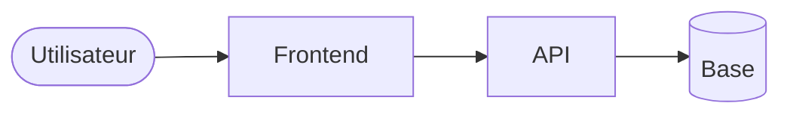

<!-- modèle : templates/architecture.md v0.1 · responsable du modèle : A -->

# Architecture technique — <projet>

Source : [cdc.md](cdc.md) (doit être VALIDÉ)

## 1. Synthèse
<SI retenu en 3 lignes>

## 2. Stack
| Couche | Technologie | Version | Justification |
|---|---|---|---|
| Frontend | | | |
| Backend | | | |
| Base de données | | | |
| Hébergement | Render (par défaut) | | |

## 3. Schéma

## 4. Données et persistance
<modèle de données, données sensibles, persistance en production>

## 5. Endpoint `/health` (obligatoire)
Renvoie au minimum `{ "status": "ok", "commit": "<SHA déployé>" }` (variable `RENDER_GIT_COMMIT` sur Render).

## 6. Couverture des exigences non fonctionnelles du CDC
| Exigence CDC | Réponse architecturale |
|---|---|

## 7. Sécurité
<authentification, secrets, surface d'attaque, dépendances>

## 8. Déploiement, sauvegarde et rollback
<service Render, base, stratégie de sauvegarde, rollback>

## 9. Décisions techniques
| # | Décision | Alternatives étudiées | Pourquoi | Coût / impact maintenance |
|---|---|---|---|---|
| 1 | | | | |

## 10. Estimation de coût d'exploitation
<hébergement, services tiers>
